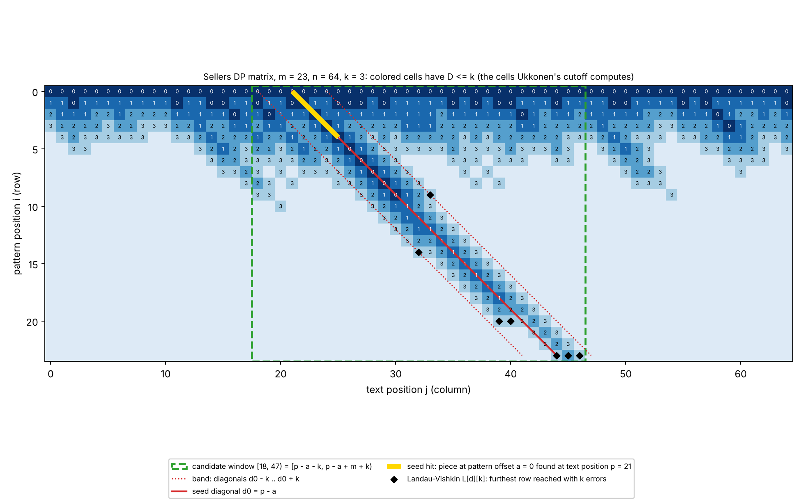

# Approximate DNA Sequence Matching: Dynamic Programming, Bit-Parallelism and Filtering Compared

*Design and Analysis of Algorithms, end-term project, Problem 8. All measurements: `results/summary.md`, `results/bench.csv`, plots in `results/`. Reproduce everything with `make bench`.*

## 1. Problem Statement

**Input.** A text T[0..n) (a genome), a pattern P[0..m) (a read), both over {A, C, G, T}, and an integer k >= 0. Edit distance ed(X, Y) is the minimum number of substitutions, insertions and deletions turning X into Y.

**k-differences problem.** Report every end position e of T such that some substring of T ending at e has ed(P, substring) <= k. This "all ends within k" definition is the one every exact algorithm here implements and is checked against.

Real sequences differ by point mutations and indels, so exact matching is not enough, and the textbook dynamic program (Needleman-Wunsch 1970 [18], Smith-Waterman 1981 [19], and its approximate-matching form by Sellers 1980 [1]) costs Theta(mn), too slow for many reads against a genome. We study how far exact methods can be pushed (banding [2], bit-parallelism [3], pigeonhole filtering [4, 5]), and what accuracy a BLAST-style heuristic [6] gives up for speed. Worst-case speedups beyond the DP are unlikely: edit distance has no O(n^(2-epsilon)) algorithm unless the Strong Exponential Time Hypothesis fails [7]. Gains come from small k / m, which is the regime of read mapping.

**Data.** Real genomes fetched from GitHub raw files (NCBI, EBI ENA, UCSC and Ensembl were unreachable from the sandbox, so *E. coli* K-12 MG1655 could not be obtained; no dataset here is called K-12):

| Dataset | Length (bp) | GC | Source |
|---|---|---|---|
| *E. coli* 536 (NC_008253.1), main text | 4,938,920 | 0.505 | BenLangmead/bowtie `genomes/NC_008253.fna` |
| SARS-CoV-2 isolate MT192765.1 | 29,829 | 0.380 | nf-core/test-datasets |
| phage lambda (NC_001416.1) | 48,502 | 0.499 | BenLangmead/bowtie2 example |
| human mitochondrial DNA | 16,569 | 0.444 | lh3/minimap2 test |
| orangutan mitochondrial DNA | 16,499 | 0.459 | lh3/minimap2 test (real homolog of the human mtDNA) |
| *Bacteroides fragilis* FDAARGOS_1225 chromosome (NZ_CP069563.1), evaluation only | 5,150,703 | 0.432 | nf-core/test-datasets (first record; a 98 kb plasmid record is ignored) |

Headers, lengths, GC and SHA-256 are in `data/SOURCES.txt`; non-ACGT characters were stripped. Reads are simulated from the genome with exactly k random edits, so a true match within k always exists; the oracle for correctness is Sellers. A synthetic 4.6 Mbp genome (random, with injected repeats) is used to fit the cost model; *B. fragilis* is used only to test it blind (Section 4); mt_orang and mt_human are matched against each other as real homologs (Section 5).

**Scope and novelty.** This is a comparative study plus an improved variant of a known technique. The frequency-aware splitting (Section 2.5) follows the idea of the Optimal Seed Solver [13] (pick pigeonhole seeds with the fewest occurrences by dynamic programming) and relates to optimal search schemes [14]. Our differences are engineering choices: seeds capped at 11 characters so that one direct-address table answers every lookup, gaps allowed between seeds, verification by Myers windows, and a calibrated cost model deciding when to fall back to a full scan. We do not claim a new algorithm. The library of methods also includes the Landau-Vishkin diagonal algorithm, Myers with block pruning and a mapping front end with CIGAR output, all standard techniques implemented here for comparison.

## 2. Algorithm

All algorithms are in `src/approx.cpp` (C++17). Notation: text T[0..n), pattern P[0..m), threshold k, alphabet {A,C,G,T}; any other character (N) matches nothing. w = 64 is the machine word size, B = ceil(m/w).

**Figure: the DP matrix, the band, the diagonals and a seed hit.** `results/dp_matrix.png` (generated by `scripts/fig_dp_matrix.py`) shows the Sellers matrix for a 23 bp read with 2 edits in a 64 bp text and k = 3. Coloured cells have D <= k: this narrow tongue around the true diagonal, plus the top rows, is all that Ukkonen's cutoff has to compute. The yellow segment is the exact seed hit of one of the k + 1 pieces, drawn on its diagonal d0 = p - a; the dotted lines are the band of diagonals d0 - k .. d0 + k that a verification explores; the green box is the candidate window [p - a - k, p - a + m + k) that the filter hands to Myers; the black diamonds are the Landau-Vishkin furthest-reaching points L[d][k] on the diagonals of the band.



### 2.1 Sellers DP (baseline and oracle)
```
D[0][j] = 0 for all j ; D[i][0] = i
D[i][j] = min( D[i-1][j-1] + [P_i != T_j],  D[i-1][j] + 1,  D[i][j-1] + 1 )
report end j when D[m][j] <= k          (one column kept, O(m) space)
```

### 2.2 Ukkonen cutoff (banded) DP
```
lact = min(m, k)                                   // last row whose value is <= k
for each text char t:
    for i = 1 .. min(lact+1, m): C[i] = min(diag + [P_i != t], C[i] + 1, C[i-1]_new + 1)
    lact = min(lact+1, m); while lact > 0 and C[lact] > k: lact--
    if lact == m: report
```
Rows below `lact + 1` are never computed.

### 2.3 Myers bit-vector (blocks of 64 rows)
State per block: `Pv` (rows whose vertical delta is +1), `Mv` (rows whose vertical delta is -1). `Eq` is the match mask of the current text character, `hin` the horizontal delta entering the block from above (0 for block 0, because D[0][j] = 0).
```
advance_block(Pv, Mv, Eq, hin):                    // returns hout
    Xv = Eq | Mv
    if hin < 0: Eq |= 1
    Xh = (((Eq & Pv) + Pv) ^ Pv) | Eq
    Ph = Mv | ~(Xh | Pv)          Mh = Pv & Xh
    hout = +1 if Ph has the block's top bit, -1 if Mh has it, else 0
    Ph <<= 1 ; Mh <<= 1 ; if hin < 0: Mh |= 1 elif hin > 0: Ph |= 1
    Pv = Mh | ~(Xv | Ph)          Mv = Ph & Xv
score = m ; for each text char: hin = 0; for each block: hin = advance_block(...); score += hin
report when score <= k
```

### 2.4 Pigeonhole filter, equal split (`filter`)
```
q = floor(m / (k+1)); seeds = { P[i*q .. i*q + min(q,11)) : i = 0..k }       // prefixes of k+1 equal pieces
H = total index hits of the seeds                                            // index: 11-mer table of T
if cost_model(H) predicts filter slower than scan: scan whole text with Myers (fallback)
windows = { [p - a - k, p - a + m + k) : seed at pattern offset a occurs at text position p }
merge overlapping windows; run Myers on each merged window
```
The index is a direct-address table over all 4^11 11-mers (CSR layout, 16 MB plus 4n bytes). A seed shorter than 11 characters is looked up as a contiguous range of the table; the few text positions that have no indexed 11-mer (text tail, or an N inside the next 11 characters) are checked directly.

### 2.5 Frequency-aware filter (`filter_fa`, our variant)
Instead of equal pieces, choose k+1 pairwise disjoint substrings of P (lengths 1 to 11, gaps allowed) that minimise the total number of occurrences in T.
```
cnt[a][L] = occurrences in T of P[a .. a+L)                 // one index lookup each, a < m, L <= 11
f[0][i] = 0
f[j][i] = min( f[j][i-1],                                   // character i-1 not used
               min_{1<=L<=min(11,i)}  f[j-1][i-L] + cnt[i-L][L] )   // last seed is P[i-L .. i)
choose the seeds by backtracking from f[k+1][m]; then proceed as in 2.4
```

**Cheaper seed selection (phase 3A).** The DP above is unchanged, but its inputs are cheaper: (1) prefix-count tables cnt_L[c] for L = 6..10, built with the index (5.4 MB), so the count of a seed costs one load instead of two random loads into the 16.8 MB offset table; (2) seed lengths are limited to [s0 - 2, min(11, s0 + 2)] with s0 = min(floor(m/(k+1)), 11) (the cap), which cuts the table and DP size 3 to 4 times for m = 100 (the equal split's seeds have length s0 and stay in the family); (3) reused flat buffers instead of nested vectors. The original selection is kept as `filter_fa_full`, and env knobs `APPROX_SEL`, `APPROX_CAP` choose the variant for the comparison in Section 4.9.

### 2.6 Cost model and fallback rule
With H seed hits, window length L_w = m + 2k, and lambda = H L_w / n, the model assumes hits are spread uniformly: merged windows W ~ H e^(-lambda), verified length V ~ n (1 - e^(-lambda)).
```
t_filter = c_hit H + c_win W + c_bp B V   (+ c_sel m 11 for filter_fa)
t_scan   = a_scan n B
fall back to a full Myers scan when t_filter > t_scan
```
The constants (nanoseconds) are fitted by non-negative least squares (all constants >= 0) on the synthetic genome, with calibration points that cover the crossover (k up to 25), and evaluated on E. coli 536. The rule is applied once before windows are built (using the estimate) and once after (with the exact merged length).

**Occupancy cost model (phase 3A).** For choosing between seed sets the uniform-hit estimate of W and V is replaced by measured occupancy: the hits of a seed set are dropped into bins of width m + 2k by diagonal (p - a); occupied bins estimate the verified length V = occupied * (m + 2k) and runs of occupied bins estimate the merged windows W, and the cost is c_hit H + c_win W + c_bp B V. For uniformly placed hits this equals the Poisson estimate; for clustered hits (repeats) it sees that they merge into few windows, which the Poisson estimate cannot. Below 64 hits every hit is charged its own window (no bins). The pass is O(H).

### 2.7 BLAST-style heuristic (`blast1`, `blast2`)
```
for every 11-mer of P found in the index: record (diagonal = p - a, offset a)
one-hit mode: every hit triggers an ungapped extension
two-hit mode: trigger only when a second NON-overlapping hit lies on the SAME diagonal within A = 40 of the previous one
ungapped extension: score +2 per match, -3 per mismatch, extend both ways, stop when the score falls X = 20 below the best
if the extension score >= 34 (a hit-segment pair, HSP): run Myers on the window [diag - k, diag + m + k)
```
Differences from real BLAST (blastn): exact 11-mer seeds only (no neighbourhood words, no substitution matrix); a fixed raw-score cutoff instead of E-values and Karlin-Altschul statistics; no gapped X-drop alignment, an HSP instead triggers an exact Myers scan of a window (so every reported match is genuine, but recall depends only on the seeding and the cutoff); no low-complexity masking; no database-level statistics; DNA only. It is a model of BLAST's seed-and-extend logic, not a re-implementation.

### 2.8 Baselines from libraries
- **Edlib** (`pip install edlib`, HW mode, `task="locations"`): returns the minimum distance and only the end positions achieving it.
- **WFA2** (`pip install pywfa`, ends-free, Levenshtein): returns one best alignment per read.

Both therefore answer "best match per read", a different question from "all ends within k". They are timed (including about 0.1 ms of Python call overhead) and checked for consistency, never compared as all-match sets. A small case shows the difference (`tests/edlib_semantics.py`): for T = TTACGTTTTACGATT, P = ACGT, k = 1, Sellers reports ends {4, 5, 6, 11, 12, 13}, while Edlib reports distance 0 and only end {5}.

### 2.9 Landau-Vishkin diagonal algorithm (`lv`)
```
L[d][e] = furthest row i reached on diagonal d = j - i (j = text column) with at most e errors;  d runs from -k to n - m + k
L[d][0] = slide(d, 0)                         for d >= 0      (row 0 is free on every diagonal d >= 0)
L[d][e] = slide(d, max( L[d][e-1] + 1,        // substitution (same diagonal)
                        L[d-1][e-1],          // text character inserted: move right, row unchanged
                        L[d+1][e-1] + 1 ))    // pattern character deleted: move down, row + 1      for e = 1..k
slide(d, i): while i < m and i + d < n and P[i] == T[i + d]: i++                       (direct character comparison)
report end index m + d - 1 for every diagonal d with L[d][e] = m for some e <= k
```
Only the layers e - 1 and e are stored. With direct comparison the work is O(1) expected per cell on random text, so O(nk) expected, and O(nm) in the worst case (long repeats). A longest-common-extension structure (suffix array, LCP array, range-minimum queries) would give O(nk) in the worst case; it is **not implemented**.

**Faster implementation (phase 3A).** The recurrence is unchanged but `lv` is restructured: the text is packed 2 bits per base once per text, every 32-base window of the pattern is precomputed once per read, and the extension is the XOR of two windows followed by count-trailing-zeros (a mismatch is the lowest non-zero 2-bit group), with no per-character loop. The layer step runs in tiles: a vectorisable pass computes the three-way maximum, and a branch-free pass extends. A chunk of 2,048 diagonals is carried through all k + 1 layers in L1-sized buffers (temporal blocking: layer e needs k - e extra diagonals on each side, about 3% recomputation at k = 30). Where the CPU has AVX-512 (checked at compile time), the extension pass handles 8 cells per iteration with two gathers (pattern window by row, an unaligned text window by byte offset, giving 29-base compares) and `lzcnt`; otherwise a scalar loop is used, and texts or patterns containing N always use the scalar loop. N is handled exactly: packed N is code 0, so the extension is truncated at the first N of the text at or after the start and the first N of the pattern. The earlier implementation remains as `lv_direct`, and the streamed-layer packed version as `lv_stream`, for comparison.

### 2.10 Myers with block pruning (`myers_pruned`)
```
S[b] = D[last row of block b][current column];  blocks 0..y are active;  y starts at the block holding row min(m, k)
for each text char:
    if y < B-1 and S[y] <= k:  y++ ; Pv[y] = all ones ; Mv[y] = 0 ; S[y] = S[y-1] + rows(y)     // activate the next block (stand-in column)
    hin = 0 ; for b = 0..y: hin = advance_block(b, hin) ; S[b] += hin
    while y > 0 and S[y] >= k + rows(y): y--                                                    // no cell <= k in block y: drop it
    if y == B-1 and S[y] <= k: report
```
This is Ukkonen's cutoff applied to blocks of 64 rows; about ceil(k/64) + 1 blocks are active instead of B. For m <= 64 (one block) both `myers` and `myers_pruned` use a register-only single-word loop (the recurrence of 2.3 with hin = 0, all state in registers, no vectors or bookkeeping); Peq is built once per read (`MyersPat`), also for the windows of a filtered read.

### 2.11 Window-aware seed selection (`filter_fa_w`)
The DP of 2.5 with the cost of a seed changed from its number of hits to `hits + lambda * windows`, where `windows` is the number of merged windows made by that seed's own hits (clusters of hit diagonals no more than m + 2k apart) and `lambda = (c_win + c_bp B (m + 2k)) / c_hit` from the fitted cost model. Seeds shorter than 9 characters, or with more hits than a cap (20,000 by default), are charged one window per hit. Everything else is as in `filter_fa`, so exactness is unchanged.

**Gated and binned window objective (phase 3B).** `filter_fa_w` now estimates a seed's windows by binning its hit diagonals into bins of width m + 2k (distinct occupied bins, O(hits), no sort; `APPROX_WBIN=0` restores the sorted estimate), which makes its selection 10 to 20 times cheaper. `filter_fa_wg` runs the window-aware selection only for repeat-heavy reads: a read is flagged when the largest hit count among its equal-split seeds is at least 100 and at least 20 times the count expected for a random seed of that length (n / 4^s0); otherwise it uses the fast `filter_fa` selection. Every choice of seeds is exact (Corollary 5).

### 2.12 Per-query method choice (`filter_auto`)
```
eq = equal-split seeds ; H_eq = hits from the index ranges (k + 1 lookups)
if c_hit * H_eq > t_scan: run the Myers scan                                  (hit cost alone exceeds a scan)
else:
    sel_est = (online estimate of ns per DP unit) * (m * nL + (k + 1) * m * nL)           nL = number of allowed seed lengths
    if c_hit * H_eq <= sel_est: cost_eq = occupancy_cost(eq); if cost_eq <= sel_est: use eq   (the DP cannot save more than the whole equal-split cost)
    select seeds with the fast DP; H_fa; cost_fa = occupancy_cost(fa)
    if cost_eq not computed and c_hit * H_eq < cost_fa: cost_eq = occupancy_cost(eq)          (otherwise eq cannot win)
    run the cheapest of: equal split (cost_eq), frequency-aware split (cost_fa), Myers scan (t_scan = a_scan * n * B)
```
(Phase 3B) When the best cost found so far exceeds 2 estimated selection costs, `filter_auto` also looks at the generalised filters of Section 2.14: for s = 2 and s = 3 it selects k + s seeds, reads their hit counts, predicts the candidate windows W with the Poisson-binomial formula below (times an empirical 2.0 fitted on *E. coli* 536), costs the option as c_hit H + c_win W + c_bp B V with V = min(n, W (m + 3k)), and takes it if it is cheaper than everything else. The prediction: a band of k + 1 diagonals contains a hit of seed i with probability p_i = 1 - exp(-h_i (k + 1) / n); the number of bands holding at least s distinct seeds is n / (k + 1) times the Poisson-binomial tail P(at least s of the p_i), plus one window for the read's own locus. It assumes uniformly placed hits; repeats only lower the true count.

All branches are exact. The constants c_hit, c_win, c_bp, a_scan come from `costmodel.json` (fitted on the synthetic genome); the seed-selection cost per DP unit is an online estimate (a running average, 0.9 / 0.1, of the measured selection time divided by its DP units), so no further calibration is needed. The skip multiplier (1.0) and the length cap (2) were chosen on *E. coli* 536 and the synthetic genome only (Section 4.9).

### 2.14 Generalised pigeonhole (`filter_s2`, `filter_s3`, `filter_fs2`, `filter_fs3`)
```
J = k + s disjoint seeds (equal split, or the fast frequency-aware DP with J seeds: filter_fs*)
keys = all seed hits as (diagonal p - a, seed), sorted
two pointers over the sorted diagonals keep the hits within k of the current diagonal and count DISTINCT seeds in that band
whenever at least s distinct seeds are in the band: emit window [dlo - k, dhi + m + k)   (windows come out in order and are merged on the fly)
verify the merged windows with Myers
```
With s = 1 this is the classic filter (`filter_s1` is checked equal to it). The point is that short seeds (needed when k/m is large) hit by chance everywhere, but s chance hits inside one band of k diagonals are far rarer than one chance hit. Note the count: k + s pieces leave at least **s** untouched pieces after at most k edits (not s + 1); requiring s + 1 hits would need k + s + 1 pieces.

### 2.13 Alignment output (`map`, `scripts/map_reads`)
```
ends = exact end positions with distance <= k (the filter of 2.4, with its fallback)
group ends into clusters whose windows overlap; for each cluster fill the semi-global DP over [first_end + 1 - (m + k), last_end]
best = the end with the minimum distance (ties: leftmost); traceback from (m, best end), preferring match/mismatch, then I, then D
CIGAR operators (SAM semantics with = and X): = match, X mismatch, I extra read base, D extra reference base
```
`scripts/map_reads GENOME READS -k K [--format tsv|sam]` writes one best alignment per read (forward strand only): TSV columns read, length, status, distance, start (0-based), end (exclusive), strand, cigar, best_ends; or SAM-like lines with `NM:i:` set to the distance. Reads with no alignment within k are reported as unmapped.


## 3. Proof of Correctness

Throughout, D[i][j] is the Sellers matrix: D[i][j] = min over starts s of ed(P[1..i], T[s+1..j]), with the empty substring allowed.

**Theorem 1 (Sellers).** The recurrence of 2.1 computes D.
*Proof.* Induction on i + j. For i = 0 the empty prefix matches the empty substring at cost 0; for j = 0 the only option is i deletions. For i, j >= 1 take an optimal alignment of P[1..i] with some T[s+1..j] and look at its last column. It is a match or mismatch of P_i with T_j (cost [P_i != T_j] plus an optimal alignment for (i-1, j-1)), or P_i deleted (cost 1 plus an optimal alignment for (i-1, j)), or T_j inserted (cost 1 plus an optimal alignment for (i, j-1)). Each remainder is again an alignment of a pattern prefix against a text substring with a free start, so it is counted by D. The minimum of the three is therefore D[i][j]. For the case s = j the alignment is only deletions, covered by the (i-1, j) term. Position j is reported iff D[m][j] <= k. QED

**Lemma 2 (neighbouring cells).** For all valid i, j: (a) |D[i][j] - D[i-1][j]| <= 1, (b) |D[i][j] - D[i][j-1]| <= 1, (c) 0 <= D[i][j] - D[i-1][j-1] <= 1.
*Proof.* "<= +1" in each direction is the recurrence (delete P_i, insert T_j, or add one match/mismatch column). For (a), D[i-1][j] <= D[i][j] + 1: in an optimal alignment for (i, j) delete the column of P_i. If P_i was matched or mismatched with a text character, that character becomes an insertion (cost +1 at most); if P_i was deleted the cost drops by 1. For (b), D[i][j-1] <= D[i][j] + 1: delete the column of T_j; if it was aligned to a pattern character that character becomes a deletion (+1 at most), if it was an insertion the cost drops by 1, and if T_j was the first character of the substring the substring becomes empty, which is allowed. For the lower bound of (c) take an optimal alignment of cost d for (i, j) and split on its last column. If it matches or mismatches P_i with T_j, dropping that column gives an alignment for (i-1, j-1) of cost at most d. If P_i is deleted, the rest is an alignment for (i-1, j) of cost d - 1, so D[i-1][j] <= d - 1 and by (b) D[i-1][j-1] <= D[i-1][j] + 1 <= d. If T_j is inserted, the rest is an alignment for (i, j-1) of cost d - 1, so D[i][j-1] <= d - 1 and by (a) D[i-1][j-1] <= D[i][j-1] + 1 <= d. QED

**Theorem 3 (Ukkonen cutoff).** A reports j iff D[m][j] <= k.
*Proof.* Let lact_j be the largest row with D[i][j] <= k (row 0 always qualifies). By Lemma 2(c), if D[i][j+1] <= k then D[i-1][j] <= k, so i - 1 <= lact_j; hence all cells of column j+1 with value <= k lie in rows [0, lact_j + 1], which are exactly the rows computed. Invariant: after column j, every stored C[i] is either the exact D[i][j] or a value greater than k. Inputs that are > k contribute at least k + 2 to the minimum, so they never create a wrong value <= k, and every output <= k is exact. A stored value <= k belongs to a row <= lact_j, which is recomputed in column j+1 (rows up to lact_j + 1 are recomputed), so stale values are always > k. Finally lact_j = m iff D[m][j] <= k. QED

**Theorem 4 (pigeonhole for ANY k+1 disjoint seeds, with window offset).** Let s_0, ..., s_k be k+1 pairwise disjoint substrings of P (a seed may be any substring, in particular a prefix of a piece), s_t = P[a_t .. a_t + len_t). If ed(P, T[i..j)) <= k then there is a t and a text position p with T[p..p + len_t) = s_t exactly, and the whole aligned substring lies inside W = [p - a_t - k, p - a_t + m + k).
*Proof.* Take an optimal alignment with at most k edit operations. An operation touches a seed if it substitutes or deletes a pattern character of that seed, or inserts a text character between two characters of that seed. Each operation touches at most one seed, since seeds are disjoint. So at most k seeds are touched and some seed s_t is untouched: its characters are aligned one-to-one to consecutive text characters, giving an exact occurrence at some p. The text aligned to P[0..a_t) has length a_t + delta1 and the text aligned to P[a_t + len_t .. m) has length (m - a_t - len_t) + delta2, where delta1 and delta2 are (insertions - deletions) in the two parts, so |delta1| + |delta2| <= k. Hence the start i = p - a_t - delta1 >= p - a_t - k and the end j = p + len_t + (m - a_t - len_t) + delta2 = p - a_t + m + delta2 <= p - a_t + m + k. QED

**Corollary 5 (the filters are exact).** `filter` and `filter_fa` report exactly the end positions reported by Sellers.
*Proof.* Completeness: by Theorem 4 every occurrence has a seed hit, and its window contains the whole alignment, so Myers on the (merged) window, which tries every start inside it, reports the same end. Soundness: windows are substrings of T, so any end reported by Myers on a window is the end of a substring of T within k edits. Merging windows only enlarges them. The seed lookup is exact: positions not covered by the 11-mer table are checked directly, and a seed containing N has no occurrence, because N matches nothing. The fallback is a full Myers scan, exact by Theorem 7. QED
The equal-split seeds (`min(q,11)`-character prefixes of k+1 pieces of length q) are disjoint, so Theorem 4 applies; the same holds for the DP-chosen seeds.

**Lemma 6 (the DP picks minimum-occurrence cuts).** Let cnt(a, L) be the number of occurrences of P[a..a+L) in T. Let f[j][i] be the minimum of the sum of cnt over all sets of j pairwise disjoint seeds of length at most 11 inside P[0..i). Then f satisfies f[0][i] = 0 and f[j][i] = min(f[j][i-1], min_{L} f[j-1][i-L] + cnt(i-L, L)), and f[k+1][m] is the minimum total number of seed hits over all valid (k+1)-seed choices. In particular the DP never has more hits than the equal split.
*Proof.* Induction on (j, i). An optimal set of j seeds inside P[0..i) either leaves character i-1 uncovered (then it lies inside P[0..i-1): value f[j][i-1]) or covers it. In the second case the seed that covers it ends exactly at i (the prefix ends there) and has some length L <= min(11, i); the other j-1 seeds are disjoint from it and lie inside P[0..i-L), and any optimal choice for them can be combined with this seed, so the value is f[j-1][i-L] + cnt(i-L, L). Taking the minimum over both cases gives the recurrence. The equal-split seeds are k+1 disjoint seeds of length at most 11, hence a feasible point, so the optimum is at most their total. QED
This optimises hit count, not running time (hits differ in how much they merge), and seeds longer than 11 are not considered because the index covers 11-mers.

**Theorem 7 (Myers bit-vector).** `advance_block` and the surrounding loop maintain: after processing T[1..j], (Pv, Mv) encode the vertical deltas of column j, and `score` = D[m][j].
*Setup.* For column j let dv_i = D[i][j] - D[i-1][j] and, for the step from column j-1, dh_i = D[i][j] - D[i][j-1]. By Lemma 2 all of these lie in {-1, 0, +1}. Row 0 has dh_0 = 0 because D[0][j] = 0 for all j. Bit i-1 of the word stands for row i. `Pv` has the bit set where dv = +1 in the old column (before the step) and `Mv` where dv = -1; `Eq` has the bit set where P_i = T_j (and no bit for N). Write pv_i, mv_i, e_i for those bits, and ph_i, mh_i for the indicators dh_i = +1, dh_i = -1 of the new step.
*Step 1: the cell rule.* Fix a cell (i, j) and write x = D[i-1][j-1]. Put a = D[i][j-1] - x = old dv_i and b = D[i-1][j] - x = dh_{i-1} (the horizontal delta entering the cell from above); both lie in {-1, 0, +1}. The recurrence is translation invariant, so D[i][j] - x = min([P_i != T_j], b + 1, a + 1). Because a, b >= -1 the last two terms are >= 0. Hence D[i][j] - x = 0 if e_i = 1 or a = -1 or b = -1, and 1 otherwise. The outputs are the new vertical delta D[i][j] - D[i-1][j] = (D[i][j] - x) - b and the horizontal delta dh_i = (D[i][j] - x) - a.
*Step 2: Boolean form of the outputs.* Let Xh_i = e_i OR mh_{i-1} (mh_0 = 0, or the injected hin, see Step 4), the condition "e_i or b = -1". Then D[i][j] - x = 0 exactly when Xh_i OR mv_i. Checking the cases: dh_i = +1 iff (D[i][j] - x = 0 and a = -1) or (D[i][j] - x = 1 and a = 0), i.e. ph_i = mv_i OR NOT(Xh_i OR pv_i) (when mv_i = 0 the second case is "not Xh and not pv"); dh_i = -1 iff (D[i][j] - x = 0 and a = +1), i.e. mh_i = pv_i AND Xh_i (pv_i and mv_i exclude each other). This is `Ph = Mv | ~(Xh | Pv)` and `Mh = Pv & Xh`. For the new vertical delta, with Xv_i = e_i OR mv_i: it is +1 iff (b = -1) or (D[i][j] - x = 1 and b = 0), i.e. new pv_i = mh_{i-1} OR NOT(Xv_i OR ph_{i-1}); it is -1 iff (D[i][j] - x = 0 and b = +1), i.e. new mv_i = ph_{i-1} AND Xv_i. Row i uses the horizontal deltas of row i-1, which is the shift by one bit: `Pv = (Mh<<1) | ~(Xv | (Ph<<1))` and `Mv = (Ph<<1) & Xv`.
*Step 3: the carry chain computes Xh.* From Step 2, mh_i = pv_i AND Xh_i, so Xh_{i+1} = e_{i+1} OR (pv_i AND Xh_i), a recurrence going down the rows. Let S = (Eq AND Pv) + Pv with carries c_i into bit i (c_1 = 0 for the lowest bit). The carry out of bit i is the majority of (e_i pv_i, pv_i, c_i), which simplifies to c_{i+1} = pv_i AND (e_i OR c_i). By induction c_i = mh_{i-1}: it holds for the lowest bit, and mh_i = pv_i AND (e_i OR mh_{i-1}) = pv_i AND (e_i OR c_i) = c_{i+1}. The sum bit is (e_i pv_i) XOR pv_i XOR c_i, so ((S XOR Pv) OR Eq)_i = ((e_i pv_i) XOR c_i) OR e_i, which equals 1 if e_i = 1 and equals c_i = mh_{i-1} if e_i = 0. That is exactly e_i OR mh_{i-1} = Xh_i. This is `Xh = (((Eq & Pv) + Pv) ^ Pv) | Eq`.
*Step 4: blocks.* Rows are split into blocks of 64. The first row of a block receives hin = dh of the row above (0 for block 0 because dh_0 = 0). In Step 2 this replaces mh_{i-1} by [hin < 0] and ph_{i-1} by [hin > 0] for the lowest row of the block. In Step 3 it means a carry-in of [hin < 0] into the chain, which the code injects as `Eq |= 1` for the Xh computation only (Xv is computed from the original Eq first, because Xv_i = e_i OR mv_i does not involve mh), and in the new Pv/Mv through `Mh |= 1` or `Ph |= 1` after the shift. `hout` is read before the shift from the block's top row (bit 63, or bit (m-1) mod 64 in the last block), and is the hin of the next block. Rows above m in the last block are padding; information only flows to higher bit positions (carries and shifts go upward), so they cannot change any row <= m.
*Step 5: induction on columns and score.* Column 0 has D[i][0] = i, so every dv = +1: `Pv = all ones, Mv = 0`; the score is D[m][0] = m. The step j-1 to j, applied block by block (each block's hin is correct by the previous block's hout), maps the encoding of column j-1 to that of column j (Steps 1 to 4). The horizontal delta of row m is dh_m, the hout of the last block, so D[m][j] = D[m][j-1] + dh_m, which is how `score` is updated. Position j is reported iff score <= k, which by Theorem 1 is the same as Sellers. QED

**Proposition 8 (the BLAST-style heuristic is sound but incomplete).** Every match it reports is genuine (verification is an exact Myers scan of a window, a substring of T). It can miss a true match: take m = 100 and an occurrence that differs from P by a substitution at every 10th position (10 edits, k = 10). Every exact run shared with P has length 9, shorter than an 11-mer, so no seed hits and nothing is reported although Sellers reports the end. The measured recall is in Section 5 and Section 6.

**Theorem 9 (Landau-Vishkin).** Let Lambda(d, e) = max { i : 0 <= i <= m, 0 <= i + d <= n, D[i][i+d] <= e } (minus infinity if empty). The array L of 2.9 equals Lambda, and the algorithm reports end j exactly when D[m][j] <= k.
*Proof.* (i) *Prefix property.* By Lemma 2(c), D is non-decreasing along a diagonal (as i grows). So the rows of diagonal d with D <= e form an initial segment of the valid rows (valid rows start at row 0 for d >= 0 and at row -d, column 0, for d < 0), and Lambda(d, e) is its last row: every earlier row of the diagonal also has D <= e.
(ii) *Base e = 0.* For d >= 0, D[i][i+d] = 0 iff P[0..i) = T[d..d+i) exactly (free start, N matches nothing), so Lambda(d, 0) = slide(d, 0). For d < 0 every cell has D >= -d > 0.
(iii) *Step e >= 1, lower bound.* Each candidate is a cell with D <= e: from (i, i+d) with D <= e - 1, a substitution gives (i+1, i+d+1) on diagonal d, a text insertion from diagonal d - 1 gives the same row i on diagonal d, and a pattern deletion from diagonal d + 1 gives row i + 1 on diagonal d, each costing at most 1 by the recurrence (a candidate row beyond m is clamped to m, which was already reached, and a candidate column beyond n is discarded). A match step costs 0, so sliding along equal characters keeps D <= e. Hence the computed value is at most Lambda(d, e).
*Upper bound.* Let r = Lambda(d, e). If D[r][r+d] <= e - 1 then r <= Lambda(d, e - 1), and the substitution candidate is at least Lambda(d, e - 1) (clamped to m), so the computed value is at least r. Otherwise D[r][r+d] = e. Walk back along the diagonal while the step into the cell is a zero-cost match, to the first cell (r1, r1+d) of this run of matches; P[i] = T[i+d] for r1 <= i < r. The value e at (r1, r1+d) was obtained by a non-match step (or r1 is the first valid row of a diagonal d < 0, reached by deletions from diagonal d + 1): by a mismatch from (r1 - 1, r1 + d - 1), whose D is e - 1, so r1 - 1 <= Lambda(d, e - 1); or by a deletion from (r1 - 1, r1 + d) on diagonal d + 1 with D = e - 1, so r1 - 1 <= Lambda(d + 1, e - 1); or by an insertion from (r1, r1 + d - 1) on diagonal d - 1 with D = e - 1, so r1 <= Lambda(d - 1, e - 1). In each case r1 is at most the maximum of the three candidates. Sliding from any start s with r1 <= s <= r reaches at least r over the run of matches, and a start s > r gives a value above r, contradicting the definition of r. So the computed value is at least r. By induction on e, L = Lambda.
(iv) *Reporting.* D[m][m+d] <= k iff Lambda(d, k) = m; the end index is m + d - 1, and the condition m - k <= m + d <= n restricts d to [-k, n - m], inside the range processed (diagonals up to n - m + k are needed because at most k deletions lead from them to a diagonal <= n - m). Each diagonal is reported once. QED
*Cost.* There are (k + 1) layers and n - m + 2k + 1 diagonals, so O(nk) cells. On one diagonal the slides of successive layers start at or after the previous end, so they advance the row at most m times in total: O(nm) worst case; on random text a slide has expected length below 1/3, so O(nk) expected.

**Theorem 10 (block pruning).** `myers_pruned` reports j iff D[m][j] <= k.
*Proof.* Let lact_j be the largest row with D[i][j] <= k (it is at least min(m, k) because D[i][j] <= i), and let bottom(y) be the last row of block y. *Invariant (A):* after column j, lact_j <= bottom(y) (all cells of blocks above y exceed k). *Invariant (B):* every computed cell value is an upper bound of the true D, and equals D whenever D <= k.
(A) holds at column 0 because y starts at the block containing row min(m, k). For the step, Lemma 2(c) gives lact_{j+1} <= lact_j + 1, so lact_{j+1} can leave the active blocks only when lact_j = bottom(y), i.e. when D[bottom(y)][j] = S[y] <= k, which is exactly the condition that activates block y + 1 before the column is computed. Dropping block y when S[y] >= k + rows(y) is safe: vertical deltas are at least -1, so every cell of the block is at least S[y] - (rows(y) - 1) > k, and by (B) no true value there can be at most k (if a true value were at most k its computed value would be too).
(B) for the newly activated block: its stand-in column has all vertical deltas +1 below the exact bottom of block y, so each stand-in value is S[y] + t, which is at least the true value (vertical bound of Lemma 2(a)); the cell rule of Theorem 7 stays valid because stand-in deltas and the computed horizontal deltas lie in {-1, 0, +1}. A cell with true D[i][j+1] <= k takes its value from a neighbour with true value at most k (diagonal: D[i-1][j] <= k; left: D[i][j] <= k - 1; up: D[i-1][j+1] <= k - 1); by (A) those neighbours lie in active blocks (or in the bottom of block y feeding the first row of an activated block), and by (B) they are computed exactly, so the cell is computed exactly; all other computed values are at least the true values, hence a computed value at most k is exact. The last block is active exactly when lact_j >= m can hold, so reporting when y = B - 1 and S[y] <= k is equivalent to D[m][j] <= k. QED
Equality with Sellers is also checked empirically (random and real data, m up to 600, k up to 200, including k above m and above 64).

**Proposition 11 (traceback).** For a read with at least one end position within k, `map` returns an alignment of minimum edit distance (ties: leftmost end), and the CIGAR has exactly that many X, I and D operations.
*Proof.* By Corollary 5 the set E of ends with distance at most k is exact, so the minimum over E is the global minimum distance (every alignment of cost at most k ends at some e in E); if E is empty no alignment within k exists. An alignment of cost at most k ending at e spans at most m + k text characters (m pattern characters aligned plus at most k insertions), so it starts at or after e + 1 - (m + k), inside the cluster window, and the window DP value at (m, e + 1 - ws) equals D[m][e + 1]. The traceback follows predecessor equalities D[i][j] = D[i-1][j-1] + cost, D[i-1][j] + 1 or D[i][j-1] + 1 down to row 0. Each step contributes exactly the cost it accounts for in D (0 for '=', 1 for X, I, D), so the operations sum to D[m][j], and the walk consumes every read character and the text interval [start, end). QED
This is also checked on 3,200 random reads (Section 5).

**Lemma 6' (capped seed lengths).** The fast selection restricts seed lengths to a range [Lmin, Lmax] containing s0 = min(floor(m/(k+1)), 11). The DP of Lemma 6 over this family returns the minimum total hits over all sets of k + 1 disjoint seeds with lengths in the range. The equal split's seeds have length s0 and (k + 1) s0 <= m, so a feasible set exists and the optimum has no more hits than the equal split. Exactness is unaffected because Corollary 5 holds for any k + 1 disjoint seeds. QED

**Corollary 5' (`filter_auto` is exact).** For every read `filter_auto` runs one of three procedures, each exact (equal-split filter and frequency-aware filter by Corollary 5, Myers scan by Theorem 7); the cost model only decides which, so the output equals Sellers' for every choice. QED

**Theorem 12 (generalised pigeonhole, s hits in a band).** Let s_0, ..., s_{J-1} be J = k + s pairwise disjoint substrings of P (s >= 1). If ed(P, T[i..j)) <= k then at least s distinct seeds occur exactly in T at positions p with diagonals d = p - a (a the seed's offset in P) that lie within a band of width k, and the whole aligned substring lies inside [dmin - k, dmax + m + k) where dmin, dmax are the smallest and largest of these diagonals.
*Proof.* Take an alignment with at most k edit operations. Each operation touches at most one seed (Theorem 4), so at most k of the J = k + s seeds are touched and at least J - k = s are untouched. An untouched seed is aligned one-to-one to consecutive text characters, so it occurs exactly at some p with diagonal d = p - a. Between two untouched seeds the diagonal changes only by the net number of insertions minus deletions located between them, which is at most the total number of edits k in absolute value, so all untouched seeds' diagonals lie within a band of width k. As in Theorem 4, for every untouched seed the alignment starts at or after d - k and ends at or before d + m + k; hence it starts at or after max(d) - k >= dmin - k and ends at or before min(d) + m + k <= dmax + m + k. QED
*Corollary 12' (the s-hit filters are exact).* The two-pointer pass reports a window for every right end whose band (the hits within k of it, counted by distinct seed) holds at least s seeds, with dlo equal to the smallest diagonal in that band and dhi the right end. For the s untouched seeds of an alignment, take as right end the hit with the largest diagonal among them: the band to its left contains all s of them (their diagonals are within k of it), so a window is emitted whose dlo is at most the smallest of their diagonals and whose dhi is that largest diagonal, which contains the alignment by the theorem. Windows are substrings of T, so verifying them with Myers reports exactly the end positions within k (soundness as in Corollary 5). Hence `filter_s2`, `filter_s3`, `filter_fs2` and `filter_fs3` return exactly Sellers' end positions, for any choice of J disjoint seeds, and `filter_auto` stays exact whichever option it picks. QED

**Proposition 9' (packed Landau-Vishkin).** The packed extension returns the same row as character-by-character sliding. (a) In the XOR of two windows, the lowest j 2-bit groups are zero iff the first j bases agree, so ctz / 2 is the length of the exact run, continued block by block while all bases of the window agree and clamped by the pattern end and the text end. (b) Packed N is code 0, so a window can wrongly report N equal to A; truncating the run at the first N of the text at or after the start (sorted position list) and at the first N of the pattern (next-N table) restores "N matches nothing". (c) *Blocking:* the value of cell (d, e) depends only on layer e - 1 at d - 1, d, d + 1, so a chunk [x0, x1) of diagonals computed at layer e over [x0 - (k - e), x1 + (k - e)) (clipped to the valid diagonals, with cells outside treated as unreachable) reproduces the unblocked values on [x0, x1) at every layer, by induction on e; each diagonal is reported by the chunk that owns it. (d) The AVX-512 loop evaluates the same expression per lane (29-base windows; lanes whose 29 bases all agree continue with the scalar block loop). QED

**Proposition 10' (single-word path).** For m <= 64 there is one block, hin = 0 and y = 0 always, so `advance_block` reduces to the register loop `myers_scan_1` and pruning has nothing to do; correctness is that of Theorem 7. QED

## 4. Complexity Analysis

n = text length, m = pattern length, k = threshold, w = 64, B = ceil(m/w), L = 11 (seed cap), H = seed hits, V = total verified (merged window) length, sigma = 4. Measured values are from *E. coli* 536 with m = 100 unless stated. A value written as a median with a range is the median and 10th to 90th percentile over 100 reads (the headline experiment); other experiments use means over 20 reads. Absolute times drift on this shared VM: the same Myers scan took 52 ms in an earlier run of the benchmark and about 71 ms in the final run reported here, and the fitted scan constant moved from 5.2 to 7.7 ns accordingly. Ratios between methods are stable; use them rather than absolute times.

| Algorithm | Time (worst case) | Space (theory) | Measured time | Measured working memory |
|---|---|---|---|---|
| Sellers | Theta(mn) | O(m) | about 0.9 s per pattern (0.83 to 0.94 s), independent of k | negligible |
| Ukkonen banded | O(kn) expected, O(mn) worst | O(m) | 76 ms at k = 1, 242 ms at k = 10, 593 ms at k = 30; about 2k + 1 cells per text character | negligible |
| Landau-Vishkin, direct extension (`lv_direct`; phase-2 measurement) | O(nk) expected, O(nm) worst | O(n + k) | 105 ms at k = 1, 488 ms at k = 10, 1,243 ms at k = 30 | 42 MB (2 layers of n + 2k ints, plus flags) |
| Landau-Vishkin, packed + blocked + AVX-512 (`lv`; phase 3A) | same bounds | n/4 bytes (packed text) + O(k) chunk buffers | 15 ms at k = 1, 41 ms at k = 5, 75 ms at k = 10, 208 ms at k = 30 (Section 4.9) | negligible |
| Myers | Theta(B n) | O(B sigma) | median 71 ms at m = 100 (B = 2), flat in k; 7.7 ns per block-character; 19 ms for m <= 60 (single-word loop, phase 3A) | negligible |
| Myers with block pruning (`myers_pruned`) | O(ceil(k/w) n) expected, Theta(B n) worst | O(B sigma) | 50 to 57 ms for k <= 20 at m = 100, 100 ms at k = 30 | negligible |
| `filter` (equal split) | build O(n + 4^L); query O(k) lookups + O(H log H) + O(V B) | 4(4^L + 1) + 4n bytes | median 0.007 to 0.040 ms for k <= 8, 0.63 ms at k = 10, then rises to Myers cost | 55 MB (index 37 MB plus build temporaries) |
| `filter_fa` | as `filter` plus seed selection O(m L^2 + k m L) | same | selection about 0.02 to 0.05 ms per query | 61 MB |
| `filter_auto` (phase 3A) | per query the cheapest of `filter`, `filter_fa`, scan by the cost model; adds O(H) occupancy passes | same index (+ 5.4 MB prefix tables) | within about 0% to 5% of the better fixed filter (Section 4.9) | 61 MB |
| BLAST-style | seed lookups O(m) + sort of hits + extensions + O(V B) | same index | 0.02 to 0.08 ms per query, no accuracy guarantee | 61 MB |
| `map` (filter + traceback) | filter + O(m (m + k)) per cluster | same index | not benchmarked separately (correctness validated, Section 5) | 61 MB |

Working memory is peak resident set size minus the steady size after the text is loaded (`scripts/memory.py`; methods whose peak stays under the transient peak of reading the file, about 20 MB, are shown as negligible). Edlib in its Python process also stayed below that level. The Landau-Vishkin worst case with a longest-common-extension structure (suffix array, LCP array, range-minimum queries) would be O(nk); that structure is **not implemented**, so even the packed `lv` has the direct-extension worst case O(nm).

**Landau-Vishkin.** There are n(k + 1) (diagonal, error) cells (3.0e7 per read at k = 5, matching the instrumented count), each updated in O(1) plus a slide that is short on random text. The phase-2 implementation (direct comparison, `lv_direct`) grew linearly in k at about 40 ms per error layer (8 ns per cell), 1.4x slower than banded at k = 1, 2.1x slower at k = 30 and 1.3x to 17x slower than Myers. The packed, blocked implementation of phase 3A (Section 2.9) is 5.2x to 6.0x faster (7.2 ns down to about 1.4 ns per cell at k = 5) and faster than plain Myers for k up to about 8 at m = 100 (Section 4.9).

**Seed-selection DP.** The count table needs m * L lookups, each of cost O(L) to form the seed code, so O(m L^2); the DP has (k+1) * m states with L transitions each, so O(k m L). For m = 100, k = 10, L = 11 this is about 11,000 transitions, measured at about 0.02 to 0.05 ms.

### 4.1 Expected-case analysis of the equal-split filter

Setting: a read of length m' is cut into k + 1 pieces of length q = floor(m' / (k + 1)); the seed of a piece is its first s = min(q, 11) characters; the text has N = n - s + 1 seed windows and lambda_s = N / 4^s.

*Seed hits for a uniform random seed.* Each text window equals a given uniform random s-mer with probability 4^(-s), so by linearity of expectation a seed has lambda_s hits, whatever the text is. For a uniform random pattern the filter therefore sees E[H] = (k + 1) lambda_s = (k + 1)(n - s + 1) / 4^s hits, exactly, on any text.

*Hits for reads.* A read carries k random edits (each a substitution, insertion or deletion with probability 1/3). Two details matter. (1) *Piece length:* insertions minus deletions change the read length to m' = m + (I - D), so q = floor(m'/(k+1)), and s, differ between reads; a read one base short can have a seed one character shorter, which has 4 times more hits. The formulas below average over the multinomial distribution of (I, D). (2) *Untouched seeds:* an edit touches a given s-character seed with probability about s/m', so a seed is untouched with probability pi = (1 - s/m')^k. An untouched seed is an exact substring of the text, so its expected hits are the size-biased count C_s = (sum over s-mers w of c(w)^2) / N (c(w) = occurrences of w; the seed's own locus is included); a touched seed behaves like a random string, with lambda_s hits. So

E[H] = sum over (I, D) of P(I, D) * (k + 1) * [ pi * C_s + (1 - pi) * lambda_s ].

On uniform random text C_s = 1 + lambda_s, which gives (k + 1)(lambda_s + pi) per length class (the "uniform-text formula"); on a real genome C_s exceeds 1 + lambda_s because of repeats and composition bias, and this is the only place where text structure enters (the "spectrum-corrected formula", with C_s computed from the text's s-mer counts).

*Windows and verified bases.* If the H hits are placed uniformly, each opens a window of length m + 2k, the coverage parameter is lambda_w = H (m + 2k) / n, the expected number of merged windows is W = H e^(-lambda_w) and the expected verified length is V = n (1 - e^(-lambda_w)). Since H is about (k + 1) n / 4^s, lambda_w is about (k + 1)(m + 2k) / 4^s, independent of n: for m = 100 it is 0.005 at k = 10 (s = 9), 0.1 at k = 12 and 13 (s = 7), 0.5 at k = 14 and 15 (s = 6) and 2.4 at k = 17 (s = 5). The filter is selective while lambda_w is small, and selectivity collapses between k = 13 and k = 17.

*Predicted crossover.* The filter costs c_hit H + c_win W + c_bp B V and a full scan costs a_scan n B. Inserting the expected H, W and V and the fitted constants of Section 4.3, the two are equal at k = 17.0 (k/m = 0.170) with the uniform-text formula on each of the three texts, and at k = 16.7 (k/m = 0.167) with the spectrum-corrected formula on *E. coli* 536; the measured crossover on *E. coli* is k/m = 0.168.

*Check against measurement* (`scripts/expected_hits.py`; mean hits per read, equal split, no fallback; (A) uniform random patterns, (B) reads with exactly k edits sampled from the text; 300 reads for k <= 12, 60 above). Agreement is the factor between measured and formula, median over the 14 values of k (worst in brackets):

| text | (A) random patterns vs formula | (B) reads vs uniform formula | (B) reads vs spectrum-corrected formula |
|---|---|---|---|
| uniform random text (no repeats) | 1.00x (1.04x) | 1.01x (1.07x) | 1.01x (1.07x) |
| synthetic genome (3% injected repeats) | 1.00x (1.04x) | 1.02x (1.06x) | 1.02x (1.06x) |
| *E. coli* 536 (real) | 1.03x (1.08x) | 1.39x (1.70x) | 1.09x (1.14x) |

On repeat-free random text the formula matches the measurement within about 1% (median), including the read-length effect (before it was included, reads at k = 10 were 1.8x above the formula). On *E. coli* the random-pattern formula (A) still matches (within 8%), because it does not depend on the text, but reads sampled from the genome have 1.4x more hits than the uniform formula (up to 1.7x): the seeds of a read come from the genome, so they are drawn in proportion to how often they occur, and repeated s-mers (for s = 11, C_s = 3.6 against 1 + lambda_s = 2.2) are over-represented. The spectrum correction accounts for that and brings the error to 1.09x. Selected rows for *E. coli* 536:

| k | q | s | (A) formula | (A) measured | (B) uniform formula | (B) spectrum-corrected | (B) measured |
|---|---|---|---|---|---|---|---|
| 1 | 50 | 11 | 2.4 | 2.5 | 4.1 | 6.7 | 6.9 |
| 4 | 20 | 11 | 5.9 | 5.6 | 9.0 | 13.5 | 15.3 |
| 8 | 11 | 11 | 10.6 | 10.1 | 22.5 | 30.6 | 34.7 |
| 10 | 9 | 9 | 207.2 | 203.6 | 387.5 | 485.2 | 536.9 |
| 12 | 7 | 7 | 3,918.8 | 3,967.6 | 3,607.0 | 4,254.5 | 4,639.1 |
| 15 | 6 | 6 | 19,292.6 | 19,580.3 | 23,776.8 | 26,580.8 | 28,771.2 |
| 17 | 5 | 5 | 86,816.9 | 85,768.4 | 86,201.2 | 94,052.5 | 96,206.8 |

and for the repeat-free random text:

| k | q | s | (A) formula | (A) measured | (B) uniform formula | (B) spectrum-corrected | (B) measured |
|---|---|---|---|---|---|---|---|
| 1 | 50 | 11 | 2.2 | 2.3 | 4.0 | 4.0 | 4.0 |
| 8 | 11 | 11 | 9.9 | 9.7 | 21.2 | 21.2 | 20.8 |
| 10 | 9 | 9 | 193.0 | 193.8 | 361.2 | 361.2 | 350.6 |
| 13 | 7 | 7 | 3,930.7 | 3,921.1 | 6,287.8 | 6,287.6 | 5,879.0 |
| 17 | 5 | 5 | 80,859.3 | 80,802.0 | 80,286.4 | 80,285.2 | 80,881.5 |

See `results/expected_hits.png` for predicted versus measured hits at every k.

### 4.2 Index build versus query time and break-even

The index (4^11 table plus positions) takes about 100 to 150 ms to build for *E. coli* 536 (about 20 ms for the 17 to 49 kbp genomes, where clearing the 16.8 MB table dominates). A query costs a median 0.007 to 0.63 ms (k <= 10) against about 71 ms for a Myers scan. The break-even number of queries Q* = index time / (Myers median time - filter median time) is therefore small (medians over 100 reads with the fallback active; the index time is one measurement per row):

| k | index (ms) | Myers (ms/query) | filter (ms/query) | Q* filter | filter_fa (ms/query) | Q* filter_fa |
|---|---|---|---|---|---|---|
| 1 | 110 | 70.8 | 0.007 | 1.6 | 0.029 | 1.8 |
| 6 | 144 | 69.7 | 0.029 | 2.1 | 0.043 | 1.5 |
| 10 | 116 | 71.3 | 0.631 | 1.7 | 0.455 | 1.8 |
| 14 | 120 | 69.3 | 32.4 | 3.3 | 14.0 | 1.9 |
| 15 | 111 | 69.6 | 35.6 | 3.3 | 23.3 | 2.3 |
| 17 | 107 | 68.7 | 70.5 | never | 54.0 | 8.2 |
| 20 | 107 | 68.9 | 71.3 | never | 72.6 | never |

About two queries (1.5 to 2.1) pay for the index for k <= 13, and about 3.3 for k = 14 and 15; at k >= 17 the equal-split filter never beats repeated scans (its fallback makes it equal to Myers plus small overhead), and `filter_fa` needs 8.2 queries at k = 17. Against Edlib (37 to 50 ms per query, 55 ms at k = 30, best-match semantics) the break-even is about 2.7 queries at k = 5 and 3.0 at k = 10 (index 101 and 108 ms). See `results/breakeven.png`. A single query against a genome you will not query again is better served by Edlib or Myers directly.

### 4.3 Cost model, and which figures are blind

Section 2.6 gives the model. Its constants are fitted by non-negative least squares (c >= 0) on the synthetic genome X (k up to 25 for m = 100 and 200) in `scripts/calibrate.py`, written once to `results/costmodel.json`, and never changed afterwards:

| constant | value |
|---|---|
| c_hit (per seed hit) | 109.7 ns |
| c_win (per merged window) | 218.6 ns |
| c_bp (per block-base verified) | 7.28 ns |
| a_scan (per block-character of a full scan) | 7.70 ns |
| c_sel (seed selection, per m * 11) | 57.7 ns |

NNLS did not set c_win to 0: the unconstrained least-squares estimate (219 ns) was already non-negative, so the sign constraint was inactive. The pipeline runs the calibration first, then evaluates on other texts, so no evaluation text influences the constants.

**Which figures are fitted, semi-blind or blind.** Error is the factor max(predicted/measured, measured/predicted) between the median predicted and the median measured per-read time of the pure filter (fallback off), median over the values of k whose measured median exceeds 0.01 ms (worst in brackets):

| text | status | reads per k | `filter` error | `filter_fa` error | Myers scan error | crossover with Myers, measured / predicted (k/m): `filter` | `filter_fa` |
|---|---|---|---|---|---|---|---|
| synthetic genome X | **fitted** (same text as the fit, new reads) | 30 | 1.13x (1.36x) | 1.10x (1.90x) | 1.08x | 0.169 / 0.169 | 0.183 / 0.185 |
| *E. coli* 536 | **semi-blind** (not fitted, but the calibration range was widened to k <= 25 after a first fit failed on this text) | 100 | 1.09x (1.27x) | 1.12x (2.36x) | 1.07x | 0.168 / 0.169 | 0.187 / 0.191 |
| *B. fragilis* | **blind** (a text that was never read before the constants were frozen) | 100 | 1.11x (1.25x) | 1.15x (2.36x) | 1.11x | 0.168 / 0.169 | 0.186 / 0.190 |

The blind figure is the last row: on a genome the model had never seen, the equal-split filter time is predicted within a median factor of 1.11 and the crossover with a Myers scan is predicted at k/m = 0.169 against 0.168 measured. The worst `filter_fa` error (2.36x, at k = 1 to 8 on both real genomes) is the seed-selection term: the model charges c_sel * m * 11, about 0.06 ms, whereas the whole measured query takes 0.03 to 0.08 ms. `results/costmodel_blind.png` shows the three texts.

The fit is sensitive to the calibration range. A first NNLS refit that used only k <= 15 gave c_win = 1,123 ns and c_bp = 2.56 ns (the number of windows and the number of bases verified are collinear, so their split is poorly determined). That model underestimated verification cost near the crossover: on the 100-read headline run at k = 20 only 13 of 100 reads fell back to a scan, and the filter's median was 84 ms against 53 ms for Myers (`results/evidence/`). Earlier unconstrained fits had given c_win = 1,073, 339 and (after clipping a negative estimate) 0; an earlier version of this report said c_win was zero for that reason. The constants also change from run to run with the speed of the VM (a_scan 5.2 ns before, 7.7 ns now), so they must be re-fitted on the machine in use.

### 4.4 Frequency-aware versus equal split

Pure filter (fallback off), median over 100 reads. `filter_fa` has 1.4 to 9.0 times fewer seed hits than the equal split at every k tested (at least 1.5 times up to k = 20), and verifies 1.0 to 9.7 times fewer bases (the gap closes as the filter approaches a full scan). In time it loses when queries are cheap and wins when they are expensive:

| k | hits equal | hits fa | time equal (ms) | time fa (ms) | fa speedup |
|---|---|---|---|---|---|
| 1 | 5 | 1 | 0.009 | 0.028 | 0.33x |
| 4 | 14 | 3 | 0.021 | 0.037 | 0.57x |
| 8 | 24 | 15 | 0.053 | 0.067 | 0.79x |
| 10 | 326 | 212 | 0.675 | 0.466 | 1.45x |
| 12 | 4,828 | 1,656 | 8.61 | 3.26 | 2.64x |
| 15 | 23,647 | 14,000 | 35.2 | 23.8 | 1.48x |
| 20 | 435,776 | 144,428 | 114.0 | 83.6 | 1.36x |

`filter_fa` is slower for k <= 8 at m = 100 (0.33x to 0.79x, that is 1.3 to 3.0 times slower), because the selection step (about 0.02 to 0.05 ms) costs more than the verification it saves, and faster for k from 10 to 30 (1.36x to 2.64x). Across read lengths at 5% error it loses for m <= 100 (m = 50: 0.008 against 0.023 ms; m = 100: 0.032 against 0.047 ms) and wins for m >= 200 (m = 200, k = 10: 1.6x; m = 400, k = 20: 2.9x; m = 800, k = 40: 7.2x, 8.3 ms against 1.1 ms; means over 20 reads).

Lemma 6 minimises hits, not verified length, and that is a real limitation. In the `lowcomplex_edge` stress case at k = 10, `filter_fa` has 4.5 times fewer hits than the equal split (2,839 against 12,693) but they fall in 2.9 times more distinct merged windows (1,536 against 531), so it verifies 2.6 times more bases (193,687 against 75,968 per read) and is twice as slow (3.25 against 1.63 ms). The equal split's hits cluster in the same low-complexity region and merge into few windows, while the DP's rarer seeds are scattered.

**Does a window-aware objective help?** `filter_fa_w` (Section 2.11) minimises hits + lambda * windows instead (`scripts/objective_test.py`; exactness checked). On the case above it does what it is meant to do for verification: 5,662 hits, 295 windows and 42,867 verified bases per read (against 193,687 for the hits-only DP and 75,968 for the equal split). But the total time gets worse, from 3.24 ms for `filter_fa` to 8.77 ms, because computing the windows of every candidate seed requires reading its hit list: seed selection alone takes 7.83 ms. Capping the hit lists that are examined at 1,000 (an extra variant tried after seeing the first result) makes selection cheap (0.19 ms) but then the objective stops working (1,515 windows, 191,528 bases, 3.64 ms). Over all 20 settings tested (five stress scenarios at k = 6, 10, 15, and an unmodified *E. coli* sweep with 100 reads), `filter_fa_w` was never more than 5% faster than `filter_fa` and was more than 5% slower in 18 settings; the capped variant was never faster either (slower in 15). So the change does not help in time: the extra information about windows costs more to get than it saves.

### 4.5 Banded versus Myers: cells updated per second, and instructions

Counting cells computed by the banded algorithm and DP cells represented by Myers (m * n per pattern; one word operation updates 64 of them):

| k | banded cells computed | banded cells/s | Myers cells represented | Myers cells/s | ratio | banded ms | Myers ms |
|---|---|---|---|---|---|---|---|
| 1 | 3.1e8 | 2.0e8 | 9.8e9 | 6.2e9 | 30x | 76.4 | 79.3 |
| 4 | 8.6e8 | 3.3e8 | 9.8e9 | 6.5e9 | 20x | 133.0 | 75.5 |
| 10 | 2.0e9 | 4.1e8 | 9.7e9 | 6.4e9 | 16x | 241.8 | 75.2 |
| 20 | 4.0e9 | 4.8e8 | 9.5e9 | 6.7e9 | 14x | 413.4 | 70.7 |
| 30 | 5.8e9 | 4.9e8 | 9.9e9 | 6.7e9 | 14x | 593.4 | 73.3 |

(Cell counts are totals over 20 patterns; these rows are means over 20 reads.) Banded does 32 times fewer cell updates than Myers represents at k = 1, yet takes about the same time, and from k = 2 it is slower; at k = 30 it is 8.1 times slower. Myers processes 14 to 30 times more cells per second.

*What was measured.* Hardware counters (`perf`) are not available in this VM: perf is not installed and the virtual machine exposes no CPU performance-monitoring device, so instructions per cell and branch misses could not be read from hardware. Instead `scripts/instr_profile.py` ran both algorithms under `valgrind --tool=cachegrind --branch-sim=yes` on a generic x86-64 build (m = 100, 150 kbp of the text, 5 patterns; instruction counts are exact counts of executed instructions, branch mispredictions come from cachegrind's simulated predictor and are indicative only; the timings above use the `-march=native` build):

| k | algorithm | instructions per text character | instructions per cell | cells per text character | simulated mispredictions per text character |
|---|---|---|---|---|---|
| 5 | banded | 229.8 | 21.4 | 10.7 | 2.02 |
| 5 | Myers | 98.7 | 0.99 | 100 | 0.62 |
| 20 | banded | 754.3 | 18.9 | 39.9 | 1.95 |
| 20 | Myers | 98.8 | 0.99 | 100 | 0.64 |

Banded executes 2.3 times (k = 5) and 7.6 times (k = 20) the instructions of Myers per text character, while its measured time is 2.0 times (k = 5, m = 100 length sweep: 147 against 72 ms) and 5.8 times (k = 20: 413 against 71 ms) that of Myers. The time gap goes in the same direction and is of similar size to the instruction gap, although the ratios are not equal (different builds, and instructions per cycle may differ). Per DP cell, banded costs about 19 to 21 instructions and Myers about 1. The simulated predictor reports more mispredictions per character for banded (about 2.0 against 0.6), but real misprediction penalties and cache behaviour were not measured, so branch misses are not established as a cause.

*Hypothesis (not measured).* Why a banded cell costs about 20 instructions while 64 Myers cells share about 50 (a block update, about 49 per block-character in the generic build) is explained here from the code, not from counters: (1) a block update packs 64 cells into a few dozen bitwise operations, while a banded cell needs three additions, two comparisons, a load and a store; (2) the banded column loop has a serial dependency (each cell needs the cell above it) that blocks vectorisation, whereas Myers carries that dependency inside the add of the carry chain; (3) the loop bound `lact` is data dependent and recomputed for every column, while Myers does the same work for every character; (4) for m = 100 the whole Myers state is two words, whereas banded reloads and stores an integer array. These are plausible but unverified. Fewer cells updated does not mean less time unless the per-cell cost is comparable.

### 4.6 Block pruning

`myers_pruned` (Section 2.10) computes only the blocks that can hold a cell of value at most k. It is exact (random cases, real genomes, and a dedicated test with m up to 600 and k up to 200 including k above m and above 64). Mean ms per read on *E. coli* 536 (20 reads):

| setting | Myers | Myers + pruning | Edlib (best/read) | pruning speedup |
|---|---|---|---|---|
| m = 100, k = 2 | 74.1 | 55.1 | 44.0 | 1.35x |
| m = 100, k = 10 | 75.2 | 53.1 | 37.0 | 1.42x |
| m = 100, k = 30 | 73.3 | 99.9 | 55.5 | 0.73x |
| m = 50, k = 2 (B = 1) | 41.2 | 50.3 | 38.0 | 0.82x |
| m = 200, k = 10 | 139.8 | 52.2 | 36.1 | 2.7x |
| m = 400, k = 20 | 242.0 | 73.7 | 41.2 | 3.3x |
| m = 800, k = 40 | 487.4 | 104.1 | 63.7 | 4.7x |

Pruning pays when the read spans several blocks and k is small against m (1.35x to 4.7x), costs about 20% more for a single block (the bookkeeping has nothing to save) and costs 1.4x when most blocks stay active (m = 100, k = 30). It does not reach Edlib, which is still 1.3x to 1.8x faster where pruning helps.

### 4.7 Peak memory

Measured peak resident set size on *E. coli* 536 (n = 4.94 Mbp), m = 100, k = 10, 5 reads (`scripts/memory.py`):

| method | peak RSS (MB) | working memory of the method (MB) | expected |
|---|---|---|---|
| Sellers, banded, Myers, Myers + pruning | 20.2 | negligible (below the loading peak) | O(m) or O(B sigma) |
| Landau-Vishkin, packed (`lv`) | 20.2 | negligible (below the loading peak) | packed text 1.2 MB plus L1-sized chunk buffers |
| Landau-Vishkin, direct (`lv_direct`) | 50.8 | 42.4 | two layers of n + 2k ints and n flags, about 44 MB |
| `filter`, `filter_fa`, `filter_fa_w`, `filter_auto`, BLAST-style, `map` | 69.3 | 60.9 | index 37 MB (16.8 MB table + 19.8 MB positions) + 5.4 MB prefix-count tables, plus build temporaries (a 17 MB counter copy, 5 MB flags) |
| Edlib (Python process) | 39.3 | negligible (below the loading peak) | library |

The text itself takes 8.4 MB after loading (2 bits would suffice; one byte per base is used), and reading the file line by line produces a transient peak of about 20 MB, which is why the scan methods show no working memory above it. The index is the price of the filter: about 61 MB working memory (5.4 MB of it the prefix-count tables added in phase 3A) against a few kilobytes for a scan.

### 4.8 Lower-bound context

Backurs and Indyk [7] show that no O(n^(2-epsilon)) algorithm exists for exact edit distance unless the Strong Exponential Time Hypothesis fails, so worst-case speedups beyond banding, bit-parallelism and diagonal transitions are not expected; all gains above come from small k relative to m and low repeat content, which is the regime of read mapping.

### 4.9 Phase 3A: cheaper seed selection, `filter_auto`, packed Landau-Vishkin, single-word Myers

The tables in Sections 4.1 to 4.8 come from the phase-2 full run. The measurements in this subsection were made afterwards with targeted quick runs (`scripts/phase3a_filter.py`, `phase3a_lv.py`, `phase3a_myers.py`, `phase3a_noise.py`) on the same VM at a later time; the VM's speed drifts, so compare ratios inside each table, not absolute times across subsections. All tuning (length cap, skip multiplier, cost-model form) used *E. coli* 536, the synthetic genome and the stress text only; *B. fragilis* was not used. Every variant below was checked against Sellers (`tests/crosscheck.py`, `crosscheck_real.py`, `test_lv.py`, `test_pruned.py`, `test_mapping.py`: 0 failures).

**Seed selection.** Mean selection time per query, mean hits of the chosen seeds and total query time (pure filter, 100 reads, best of 3 runs):

| k | original DP (all lengths 1..11, per-seed lookups) | prefix tables, all lengths 1..11 | tables + length cap 3 | tables + length cap 2 (default) | tables + length cap 1 |
|---|---|---|---|---|---|
| 1 | 17.3 us, 1 hits, 0.020 ms | 8.6 us, 1 hits, 0.010 ms | 4.5 us, 1 hits, 0.006 ms | 4.1 us, 1 hits, 0.006 ms | 2.9 us, 1 hits, 0.005 ms |
| 4 | 20.2 us, 3 hits, 0.024 ms | 11.2 us, 3 hits, 0.015 ms | 5.8 us, 3 hits, 0.009 ms | 4.7 us, 3 hits, 0.008 ms | 3.6 us, 3 hits, 0.007 ms |
| 8 | 26.6 us, 16 hits, 0.049 ms | 15.2 us, 16 hits, 0.039 ms | 6.8 us, 16 hits, 0.029 ms | 6.8 us, 16 hits, 0.032 ms | 4.7 us, 16 hits, 0.029 ms |
| 10 | 34.4 us, 215 hits, 0.403 ms | 19.3 us, 215 hits, 0.375 ms | 11.7 us, 215 hits, 0.355 ms | 10.0 us, 215 hits, 0.366 ms | 7.4 us, 222 hits, 0.384 ms |
| 12 | 49.3 us, 1760 hits, 2.997 ms | 39.3 us, 1760 hits, 3.511 ms | 19.2 us, 1760 hits, 3.073 ms | 16.2 us, 1760 hits, 3.149 ms | 9.9 us, 1801 hits, 3.100 ms |
| 15 | 73.6 us, 14685 hits, 22.648 ms | 46.6 us, 14685 hits, 22.928 ms | 27.5 us, 14685 hits, 21.580 ms | 25.6 us, 14685 hits, 22.874 ms | 18.0 us, 14770 hits, 22.658 ms |

Prefix tables alone cut the selection time by 1.3x to 2.0x; the length cap adds a further 1.9x to 2.4x; cap 2 gives 4.1, 4.7 and 6.8 microseconds at k = 1, 4 and 8 (target: under 10) and the same hits as the full-length DP at every k tested. Cap 1 is cheaper still but chose worse seeds at k >= 10 (222 against 215 hits at k = 10, 1,801 against 1,760 at k = 12), so cap 2 is the default. Seed selection is now cheap enough that `filter_fa` beats the equal split even at k = 1 to 8 in these runs (for example 0.0061 against 0.0075 ms at k = 1 and 0.011 against 0.028 ms at k = 6), which reverses the phase-2 finding that it loses there.

**`filter_auto`.** Mean ms per query, best of 3 runs (100 reads in every setting); `auto/best` is `filter_auto` divided by the smaller mean of `filter` and `filter_fa`. Choices count queries per decision (skip = the DP was not run, a subset of eq):

| text | setting | filter | filter_fa | filter_auto | auto/best | choices (skip / eq / fa / scan) |
|---|---|---|---|---|---|---|
| E. coli 536 | m=100, k=1 | 0.0075 | 0.0061 | 0.0053 | 0.87 | 8 / 9 / 91 / 0 |
| E. coli 536 | m=100, k=2 | 0.0136 | 0.0059 | 0.0058 | 0.99 | 2 / 2 / 98 / 0 |
| E. coli 536 | m=100, k=4 | 0.0220 | 0.0078 | 0.0081 | 1.05 | 0 / 0 / 100 / 0 |
| E. coli 536 | m=100, k=6 | 0.0278 | 0.0110 | 0.0112 | 1.02 | 0 / 0 / 100 / 0 |
| E. coli 536 | m=100, k=8 | 0.0508 | 0.0302 | 0.0291 | 0.96 | 0 / 7 / 93 / 0 |
| E. coli 536 | m=100, k=10 | 0.8039 | 0.3715 | 0.3997 | 1.08 | 0 / 1 / 99 / 0 |
| E. coli 536 | m=100, k=11 | 2.2446 | 1.2523 | 1.2484 | 1.00 | 0 / 1 / 99 / 0 |
| E. coli 536 | m=100, k=12 | 7.8155 | 3.5026 | 3.0968 | 0.88 | 0 / 0 / 100 / 0 |
| E. coli 536 | m=100, k=13 | 12.0550 | 6.7190 | 6.5412 | 0.97 | 0 / 1 / 99 / 0 |
| E. coli 536 | m=100, k=14 | 28.2478 | 13.3296 | 12.8947 | 0.97 | 0 / 0 / 100 / 0 |
| E. coli 536 | m=100, k=15 | 35.8575 | 22.0568 | 23.0967 | 1.05 | 0 / 0 / 100 / 0 |
| E. coli 536 | m=100, k=17 | 66.3081 | 48.0851 | 49.4433 | 1.03 | 0 / 0 / 100 / 0 |
| E. coli 536 | m=100, k=20 | 66.4618 | 67.1910 | 64.9385 | 0.98 | 0 / 0 / 2 / 98 |
| E. coli 536 | m=200, k=10 | 0.1520 | 0.0256 | 0.0242 | 0.95 | 0 / 0 / 100 / 0 |
| E. coli 536 | m=400, k=20 | 1.0157 | 0.0923 | 0.0919 | 1.00 | 0 / 0 / 100 / 0 |
| E. coli 536 | m=800, k=40 | 7.2595 | 0.3951 | 0.4208 | 1.07 | 0 / 0 / 100 / 0 |
| synthetic | m=100, k=2 | 0.0082 | 0.0067 | 0.0056 | 0.83 | 1 / 1 / 99 / 0 |
| synthetic | m=100, k=8 | 0.0306 | 0.0204 | 0.0207 | 1.02 | 0 / 7 / 93 / 0 |
| synthetic | m=100, k=10 | 0.5589 | 0.3446 | 0.3289 | 0.95 | 0 / 16 / 84 / 0 |
| synthetic | m=100, k=12 | 5.8112 | 2.8739 | 2.8752 | 1.00 | 0 / 1 / 99 / 0 |
| synthetic | m=100, k=15 | 29.3480 | 22.6892 | 22.0704 | 0.97 | 0 / 3 / 97 / 0 |
| stress | low-complexity edge, k=6 | 0.4552 | 0.0381 | 0.0392 | 1.03 | 0 / 1 / 99 / 0 |
| stress | low-complexity inside, k=6 | 0.7407 | 0.5956 | 0.5677 | 0.95 | 0 / 0 / 100 / 0 |
| stress | clustered, k=6 | 0.0425 | 0.0208 | 0.0197 | 0.94 | 0 / 0 / 100 / 0 |
| stress | low-complexity edge, k=10 | 1.3373 | 2.2465 | 1.2881 | 0.96 | 0 / 49 / 51 / 0 |
| stress | low-complexity inside, k=10 | 1.7407 | 1.4518 | 1.3958 | 0.96 | 0 / 17 / 83 / 0 |
| stress | clustered, k=10 | 1.0221 | 0.4524 | 0.4539 | 1.00 | 0 / 0 / 100 / 0 |
| stress | low-complexity edge, k=15 | 31.9837 | 22.2839 | 21.9175 | 0.98 | 0 / 14 / 86 / 0 |
| stress | low-complexity inside, k=15 | 24.9067 | 18.6762 | 18.2589 | 0.98 | 0 / 14 / 86 / 0 |
| stress | clustered, k=15 | 37.6503 | 23.3706 | 23.1225 | 0.99 | 0 / 1 / 99 / 0 |

Worst auto/best ratio: 1.08 (E. coli 536, m=100, k=10); 2 of 30 settings exceed 1.05: E. coli 536 m=100, k=10 (1.08); E. coli 536 m=800, k=40 (1.07).

The 5% target is met in 28 of 30 settings of this single run (most ratios lie between 0.83 and 1.05), and the two exceptions are settings whose ratio flipped between runs. A repeat check with 300 reads and 6 interleaved runs per algorithm shows how noisy the VM is:

| setting | filter_fa runs: min to max (ms) | filter_auto runs: min to max (ms) | spread of the same algorithm | ratio of medians auto / fa | ratio of minima |
|---|---|---|---|---|---|
| m=100, k=10 | 0.408 to 0.580 | 0.410 to 0.596 | 42% | 0.887 | 1.005 |
| m=800, k=40 | 0.407 to 0.659 | 0.443 to 0.651 | 62% | 1.296 | 1.089 |

The same algorithm varied by 42% and 62% between identical runs, so a 5% bound cannot be certified on this VM for every setting: the overhead of `filter_auto` over the best fixed choice is typically 0% to 5%, and two repeat checks of the same setting (m = 800, k = 40) gave a ratio of medians of 1.01 in an earlier inline check and 1.30 in the saved one (ratio of minima 1.005 and 1.09). In the stress case that motivated the occupancy cost model (low-complexity edge, k = 10) `filter_auto` is faster than both fixed filters (1.29 against 1.34 and 2.25 ms), choosing the equal split for 49 of 100 reads.

**Variants tried and what happened** (selection and `filter_auto`):
1. *Original DP*: 17 to 49 microseconds at k = 1 to 12 (baseline).
2. *Prefix tables, all lengths*: 1.3x to 2x cheaper, identical hits. Kept.
3. *Length cap 3, 2, 1*: cap 2 chosen; cap 1 loses hit quality at k >= 10.
4. *First `filter_auto` (Poisson cost model, DP skipped when predicted equal-split cost <= 2 x selection cost)*: failed on the low-complexity stress case, ratio 2.02 in a 20-read check, because the model assumes uniformly placed hits and wrongly preferred `filter_fa` there (fewer hits, but scattered). Replaced by the occupancy cost model (ratio 0.96).
5. *Eager costing of the equal split*: correct but +30 to 40 microseconds on stress reads whose equal split has 20,000 hits (ratio 1.38 at k = 6 on one stress setting). Fixed by costing it lazily with the lower bound c_hit * H_eq.
6. *Skip multiplier 0, 1, 2, 4* (E. coli and synthetic, k = 1 to 8): 0, 1 and 2 are indistinguishable at microsecond scale (noise about 10%), 4 is clearly worse (up to 1.58x). Chose 1.0, the principled value (the DP cannot save more than the whole equal-split cost). Because selection is now cheap, the skip rule rarely fires (8% of queries at k = 1, 2% at k = 2, almost never above).
7. *Small-H shortcut and reciprocal multiply in the occupancy pass, reused buffers*: these trimmed the fixed per-query overhead (a few microseconds each, not measured separately). Together with the lazy costing and skip multiplier 1, they took the ratio at k = 2, 4, 6 from 1.25, 1.18, 1.14 to 0.99, 1.05, 1.02.

**Landau-Vishkin** (*E. coli* 536, m = 100, 5 reads, best of 3 runs, ms per read):

| k | phase-2 LV | lv_direct (control) | lv_stream | lv scalar blocked | lv AVX-512 (default) | speedup of default vs phase-2 | Myers |
|---|---|---|---|---|---|---|---|
| 1 | 92.8 | 90.3 | 53.5 | 40.9 | 15.5 | 5.97x | 61.2 |
| 5 | 212.3 | 214.4 | 148.4 | 121.6 | 40.5 | 5.24x | 61.5 |
| 10 | 426.8 | 425.8 | 270.6 | 237.5 | 75.4 | 5.66x | 67.2 |
| 30 | 1189.8 | 1175.7 | 699.3 | 706.4 | 207.9 | 5.72x | 69.4 |

Variants: the packed XOR + ctz extension alone (`lv_stream`) gave about 1.5x; temporal blocking gave a small and inconsistent gain (134 against 132 ms at k = 5 in one run, 122 against 148 ms in the table above, 706 against 699 ms at k = 30; the scalar cell is instruction-bound at about 30 instructions or 4.4 ns, not memory-bound); the AVX-512 cell loop gave the large step: 5.2x to 6.0x faster than phase 2 at every k tested, exact. On a CPU without AVX-512 the scalar blocked loop is 1.7x to 2.3x faster than phase 2. The target of at least 3x at k = 5, m = 100 is met (5.2x). From the measured points, `lv` is faster than plain Myers for k up to about 8, than pruned Myers for k up to about 6, and than Edlib (best-match only) for k up to about 3 to 4 at m = 100 (interpolated between k = 1, 5, 10, 30); beyond that its O(nk) growth wins out.

**Myers and Myers with pruning at one block** (*E. coli* 536, 10 reads, best of 5 runs, ms per read; rows with m <= 60 are one block for every read; an earlier version of this table used m = 64, where about half the reads grow past 64 bases and need a second block, which mixed one- and two-block scans and showed a spurious 1.5x difference between two identical loops):

| m (blocks) | k | Myers phase 2 | Myers now | pruned phase 2 | pruned now | pruned now / Myers now | pruned now vs phase-2 pruned | Edlib (best/read) |
|---|---|---|---|---|---|---|---|---|
| 20 (1) | 2 | 39.6 | 19.3 | 46.3 | 18.6 | 0.96 | 2.49x | 43.8 |
| 32 (1) | 5 | 38.9 | 19.0 | 48.6 | 19.4 | 1.02 | 2.50x | 34.4 |
| 50 (1) | 2 | 39.7 | 19.4 | 48.5 | 19.6 | 1.01 | 2.47x | 34.6 |
| 50 (1) | 5 | 37.6 | 18.7 | 50.2 | 18.9 | 1.02 | 2.65x | 35.4 |
| 50 (1) | 10 | 40.8 | 19.6 | 48.8 | 19.0 | 0.97 | 2.58x | 33.2 |
| 56 (1) | 5 | 39.0 | 19.2 | 45.8 | 18.7 | 0.98 | 2.44x | 34.7 |
| 60 (1) | 2 | 37.7 | 18.7 | 49.2 | 18.8 | 1.00 | 2.62x | 35.9 |
| 100 (2) | 5 | 66.1 | 68.8 | 46.9 | 46.4 | 0.67 | 1.01x | 34.8 |
| 100 (2) | 20 | 67.9 | 75.0 | 46.9 | 48.6 | 0.65 | 0.96x | 36.2 |

At one block the pruned scan takes 0.96 to 1.02 times the time of plain Myers (they now run the same loop), against 1.2x to 1.3x slower in phase 2; both are about 2.0x faster than phase-2 plain Myers (39 to 19 ms) and 2.4x to 2.7x faster than phase-2 pruned, and 1.7x to 2.3x faster than Edlib at m <= 60. The Peq table was already built once per read; the gain is from dropping the per-scan vector set-up and carry bookkeeping. For two or more blocks nothing changed (the m = 100 rows).

### 4.10 Phase 3B: generalised pigeonhole and the gated window objective

As in Section 4.9, these are targeted runs (`scripts/phase3b_filter_s.py`, `phase3b_gate.py`, `phase3b_auto.py`) on the same VM at a later time; compare ratios within a table. Tuning (the length cap, the prediction multiplier 2.0, the trigger 2, the gate thresholds) used *E. coli* 536, the synthetic genome and the synthetic stress text only. Evaluation on real homologs used the mt_orang segments against mt_human. Every s-hit variant is checked against Sellers (`tests/crosscheck.py`, `crosscheck_real.py`: 1,440 real-data comparisons, and `tests/test_filter_s.py`: 1,120 comparisons on 800 planted reads including `filter_auto` with the s-hit options forced on, k up to 25, indel-heavy and clustered edits, repeats and N): 0 failures.

**Generalised pigeonhole.** Pure filters (fallback off), mean ms per read with the number of merged candidate windows in brackets (50 reads for *E. coli*, 100 segments for the mt data):

| text | k | Myers | filter | filter_fa | filter_s2 | filter_s3 | filter_fs2 | filter_fs3 |
|---|---|---|---|---|---|---|---|---|
| E. coli 536, m = 100 (10% error) | 10 | 75.678 | 1.238 (493 w) | 0.588 (215 w) | 0.082 (5 w) | 0.274 (1 w) | 0.049 (2 w) | 0.103 (1 w) |
| E. coli 536, m = 100 (12% error) | 12 | 75.303 | 8.434 (4023 w) | 3.631 (1702 w) | 0.984 (231 w) | 1.439 (27 w) | 0.329 (40 w) | 0.523 (4 w) |
| E. coli 536, m = 100 (15% error) | 15 | 75.254 | 42.950 (11915 w) | 25.572 (9720 w) | 25.081 (7123 w) | 13.615 (2474 w) | 5.981 (1839 w) | 3.972 (339 w) |
| E. coli 536, m = 100 (17% error) | 17 | 79.607 | 77.715 (7007 w) | 54.495 (12610 w) | 48.431 (10765 w) | 52.271 (4772 w) | 27.947 (7723 w) | 17.285 (3380 w) |
| E. coli 536, m = 100 (20% error) | 20 | 78.797 | 114.097 (521 w) | 85.346 (2859 w) | 115.084 (222 w) | 119.190 (2199 w) | 89.646 (6764 w) | 83.850 (9138 w) |
| E. coli 536, m = 100 (25% error) | 25 | 73.376 | 261.709 (1 w) | 141.522 (2 w) | 302.836 (2 w) | 308.442 (1 w) | 154.237 (3 w) | 180.331 (6 w) |
| mt_orang vs mt_human, m = 100 | 15 | 0.249 | 0.160 (45 w) | 0.116 (38 w) | 0.176 (40 w) | 0.078 (20 w) | 0.043 (10 w) | 0.030 (4 w) |
| mt_orang vs mt_human, m = 100 | 20 | 0.246 | 0.360 (1 w) | 0.353 (5 w) | 0.467 (1 w) | 0.486 (3 w) | 0.321 (13 w) | 0.328 (21 w) |
| mt_orang vs mt_human, m = 100 | 25 | 0.253 | 1.082 (1 w) | 0.573 (1 w) | 0.980 (1 w) | 1.200 (1 w) | 0.495 (1 w) | 0.606 (1 w) |
| mt_orang vs mt_human, m = 200 | 30 | 0.602 | 0.510 (7 w) | 0.543 (21 w) | 0.362 (20 w) | 0.155 (13 w) | 0.224 (15 w) | 0.147 (6 w) |
| mt_orang vs mt_human, m = 200 | 40 | 0.492 | 0.750 (1 w) | 0.607 (1 w) | 0.840 (1 w) | 0.813 (1 w) | 0.631 (1 w) | 0.650 (1 w) |

The full table (seed hits, bases verified, candidate-generation time) is in `results/phase3b_filter_s.md`. At 10 to 12% error the s = 2 filters verify 2 to 40 windows instead of 215 to 1,700: `filter_fs2` is 12x faster than `filter_fa` at k = 10 (0.049 against 0.588 ms) and 11x at k = 12 (0.329 against 3.63 ms), and 1,500x and 230x faster than a Myers scan. At 15 to 17% error s = 3 wins (`filter_fs3`: 3.97 ms at k = 15, 6.4x faster than `filter_fa` and 19x faster than Myers; 17.3 ms at k = 17, 4.6x faster than Myers where `filter_fa` is 1.5x). Frequency-aware seeds beat equal-split seeds in every case here, by 1.5x to 7x. At 20% error and above they stop helping (k = 20: 84 to 94 ms against 79 ms for Myers; the 4-base seeds occur about every 256 bases, so even pairs and triples in a band cover the whole text), so the crossover with a scan stays at about k/m = 0.19 to 0.20 for every variant; what changes is how much faster the filter is below it. On the real homologs (median distance 15%): `filter_fs3` takes 0.030 ms at k = 15 against 0.116 for `filter_fa` and 0.249 for Myers (8.3x), and for 200 bp segments at k = 30 `filter_s3` and `filter_fs3` take 0.155 and 0.147 ms against 0.543 for `filter_fa` and 0.602 for Myers (4x); at k = 20 (m = 100) and k = 40 (m = 200) there is no gain.

**`filter_auto` with the s-hit options.** Mean ms per read with the fallback active, best of 3 runs, 100 reads; `filter_auto (no s)` is the phase-3A rule (`APPROX_AUTOS=0`):

| text | setting | Myers | filter | filter_fa | filter_fs2 | filter_fs3 | filter_auto (no s) | filter_auto | auto / best fixed | choices s2 / s3 |
|---|---|---|---|---|---|---|---|---|---|---|
| E. coli 536 | m=100, k=6 | 72.870 | 0.032 | 0.013 | 0.009 | 0.010 | 0.012 | 0.013 | 1.56 | 24 / 0 |
| E. coli 536 | m=100, k=8 | 73.870 | 0.061 | 0.034 | 0.015 | 0.022 | 0.034 | 0.026 | 1.72 | 95 / 0 |
| E. coli 536 | m=100, k=10 | 73.462 | 0.928 | 0.423 | 0.047 | 0.102 | 0.428 | 0.067 | 1.42 | 100 / 0 |
| E. coli 536 | m=100, k=12 | 72.752 | 8.786 | 3.541 | 0.311 | 0.501 | 3.361 | 0.350 | 1.13 | 100 / 0 |
| E. coli 536 | m=100, k=14 | 72.484 | 31.091 | 14.421 | 2.175 | 1.923 | 14.535 | 1.978 | 1.03 | 59 / 41 |
| E. coli 536 | m=100, k=15 | 74.985 | 38.952 | 24.585 | 5.646 | 3.833 | 25.074 | 3.874 | 1.01 | 2 / 98 |
| E. coli 536 | m=100, k=17 | 72.343 | 72.545 | 53.115 | 26.051 | 16.740 | 53.079 | 16.898 | 1.01 | 0 / 100 |
| E. coli 536 | m=100, k=20 | 73.286 | 73.578 | 72.866 | 89.584 | 93.647 | 73.544 | 72.580 | 1.00 | 0 / 6 |
| E. coli 536 | m=200, k=20 | 142.330 | 4.040 | 1.558 | 0.064 | 0.085 | 1.559 | 0.114 | 1.77 | 100 / 0 |
| E. coli 536 | m=200, k=30 | 142.795 | 132.013 | 97.586 | 31.584 | 10.224 | 96.565 | 10.080 | 0.99 | 0 / 100 |
| E. coli 536 | m=400, k=60 | 260.604 | 266.774 | 256.485 | 191.648 | 100.275 | 253.296 | 102.144 | 1.02 | 0 / 97 |
| synthetic | m=100, k=10 | 68.046 | 0.637 | 0.382 | 0.044 | 0.101 | 0.374 | 0.061 | 1.38 | 100 / 0 |
| synthetic | m=100, k=12 | 68.215 | 6.266 | 3.233 | 0.282 | 0.551 | 3.334 | 0.319 | 1.13 | 100 / 0 |
| synthetic | m=100, k=15 | 68.321 | 32.289 | 24.772 | 6.487 | 4.525 | 25.253 | 4.844 | 1.07 | 6 / 94 |
| mt_orang vs mt_human (real) | m=100, k=15 | 0.258 | 0.162 | 0.130 | 0.044 | 0.031 | 0.115 | 0.051 | 1.63 | 0 / 100 |
| mt_orang vs mt_human (real) | m=100, k=20 | 0.242 | 0.251 | 0.257 | 0.317 | 0.335 | 0.255 | 0.279 | 1.15 | 0 / 0 |
| mt_orang vs mt_human (real) | m=200, k=30 | 0.486 | 0.480 | 0.413 | 0.205 | 0.105 | 0.416 | 0.180 | 1.72 | 0 / 100 |

Worst auto/best-fixed ratio: 1.77 (E. coli 536, m=200, k=20); 11 of 17 settings exceed 1.05.

The cost model does support the extension: with the s-hit options `filter_auto` is 3x to 10x faster than the 3A version in the 10 to 17% error range on *E. coli* (k = 10: 0.067 against 0.428 ms; k = 12: 0.350 against 3.36; k = 15: 3.87 against 25.1; k = 17: 16.9 against 53.1, which is 4.3x faster than Myers) and on the synthetic genome, 2.3x on the real homologs at k = 15 (0.051 against 0.115 ms) and 2.3x at m = 200, k = 30, and it never loses at k = 20 (72.6 against 73.3 ms for Myers: all queries go to the scan, or to 3-hit for 6%). The ratio to the best fixed method in hindsight exceeds 1.05 in 11 of 17 settings, up to 1.77, but only where the whole query takes less than about 0.3 ms (k <= 10 and m = 200, k = 20: for example 0.067 against 0.047 ms): `filter_auto` has to evaluate the options (two extra seed selections and a window prediction, about 10 to 30 microseconds) and hindsight does not pay for that information. For queries above 0.3 ms the ratio is 1.00 to 1.15. The model's prediction of the window count is 1.1x to 2.6x low on *E. coli* before the multiplier (measured windows against the Poisson-binomial estimate, k = 10 to 17), and on the 16.5 kb text the model constants (fitted on 4.6 Mb genomes) mis-rank the options at k = 20 (`filter_auto` 0.279 ms against 0.242 for Myers).

**Gated window objective.** Fraction of reads flagged and, before and after, pure filters (mean ms per read, best of 3; seed-selection ms in brackets); `sort` is the phase-2 estimate, `binned` the new one:

| scenario | k | reads flagged | ratio median | ratio p90 |
|---|---|---|---|---|
| E. coli uniform | 6 | 0 of 100 | 5.8 | 10.0 |
| E. coli uniform | 10 | 0 of 100 | 3.2 | 5.0 |
| E. coli uniform | 15 | 0 of 100 | 2.4 | 3.1 |
| stress uniform | 6 | 0 of 100 | 5.8 | 9.2 |
| stress uniform | 10 | 1 of 100 | 3.4 | 5.5 |
| stress uniform | 15 | 0 of 100 | 2.5 | 4.6 |
| stress clustered | 6 | 1 of 100 | 5.8 | 9.2 |
| stress clustered | 10 | 1 of 100 | 3.4 | 6.3 |
| stress clustered | 15 | 0 of 100 | 2.4 | 4.2 |
| stress low-complexity edge | 6 | 97 of 100 | 4843.3 | 5655.8 |
| stress low-complexity edge | 10 | 94 of 100 | 189.0 | 362.0 |
| stress low-complexity edge | 15 | 0 of 100 | 5.3 | 6.4 |
| stress low-complexity inside | 6 | 100 of 100 | 3931.7 | 5655.8 |
| stress low-complexity inside | 10 | 96 of 100 | 188.2 | 362.0 |
| stress low-complexity inside | 15 | 0 of 100 | 5.4 | 6.4 |

| scenario | k | filter (equal split) | filter_fa (hits) | filter_fa_w, sort estimate (phase 2) | filter_fa_w, binned estimate | filter_fa_wg (gated, binned) | filter_fa_wg (gated, sort estimate) | filter_auto |
|---|---|---|---|---|---|---|---|---|
| stress low-complexity edge | 6 | 0.477 (0.000) | 0.042 (0.005) | 11.558 (11.520) | 0.680 (0.646) | 0.700 (0.664) | 11.349 (11.310) | 0.042 (0.005) |
| stress low-complexity edge | 10 | 1.503 (0.000) | 2.603 (0.015) | 9.560 (8.643) | 1.495 (0.549) | 1.517 (0.547) | 9.634 (8.680) | 1.435 (0.014) |
| stress low-complexity edge | 15 | 34.572 (0.000) | 25.893 (0.025) | 33.373 (4.513) | 29.097 (0.361) | 28.239 (0.027) | 27.246 (0.026) | 25.000 (0.023) |
| stress low-complexity inside | 6 | 0.771 (0.000) | 0.569 (0.006) | 24.582 (23.953) | 1.832 (1.288) | 1.904 (1.335) | 23.506 (22.909) | 0.717 (0.007) |
| stress low-complexity inside | 10 | 1.889 (0.000) | 1.580 (0.011) | 17.498 (16.085) | 2.288 (0.937) | 2.264 (0.911) | 16.611 (15.272) | 1.482 (0.010) |
| stress low-complexity inside | 15 | 26.560 (0.000) | 20.691 (0.020) | 36.679 (10.218) | 25.715 (0.627) | 19.285 (0.018) | 19.476 (0.018) | 20.019 (0.018) |
| E. coli uniform | 6 | 0.033 (0.000) | 0.013 (0.006) | 0.132 (0.124) | 0.053 (0.046) | 0.013 (0.006) | 0.014 (0.006) | 0.012 (0.005) |
| E. coli uniform | 10 | 0.928 (0.000) | 0.425 (0.012) | 0.725 (0.182) | 0.500 (0.071) | 0.428 (0.013) | 0.427 (0.013) | 0.437 (0.014) |
| E. coli uniform | 15 | 39.063 (0.000) | 24.400 (0.026) | 25.075 (0.191) | 24.650 (0.119) | 25.045 (0.027) | 25.397 (0.027) | 25.329 (0.026) |
| stress clustered | 6 | 0.046 (0.000) | 0.023 (0.006) | 0.365 (0.348) | 0.080 (0.064) | 0.037 (0.020) | 0.235 (0.218) | 0.024 (0.007) |
| stress clustered | 10 | 1.108 (0.000) | 0.510 (0.013) | 1.251 (0.740) | 0.634 (0.105) | 0.534 (0.039) | 1.054 (0.559) | 0.536 (0.014) |
| stress clustered | 15 | 38.551 (0.000) | 25.297 (0.028) | 26.564 (0.852) | 26.613 (0.167) | 25.637 (0.026) | 26.377 (0.029) | 26.775 (0.027) |

The gate separates well: 0 of 30 ordinary reads are flagged (the largest-seed-count ratio is 2 to 11 times the random expectation) against 28 to 30 of 30 low-complexity reads at k = 6 and 10 (ratio 100 to 5,000); at k = 15 the seeds are so short that the ratio is never large (nothing flagged). It matters for ordinary reads: ungated `filter_fa_w` costs 18% (binned) to 70% (sorted) more than `filter_fa` on *E. coli* at k = 10 (0.500 and 0.725 against 0.425 ms), while the gated version costs the same as `filter_fa` (0.428 ms). The binned estimate is the larger fix: window-aware selection falls from 8.6 to 0.55 ms on the low-complexity edge case at k = 10 and from 24 to 1.3 ms on the inside case at k = 6. **Before and after on the stress cases that failed:** at low-complexity edge, k = 10 the objective now helps (gated binned 1.52 ms against 2.60 for `filter_fa`, the same as the equal split 1.50, and 9.6 ms before), but at edge k = 6 it hurts (0.70 against 0.042 ms for `filter_fa`: the hits-only seeds already have 12 hits, and the window computation costs 0.66 ms) and on the inside cases it stays worse than `filter_fa` (k = 6: 1.90 against 0.57; k = 10: 2.26 against 1.58). `filter_auto` is at or near the best in every one of these cases (0.042, 1.44, 0.72, 1.48 ms), so the window objective is not needed there: the occupancy cost model of Section 2.12 already makes the choice. Conclusion: gating and binning make the window objective safe and cheap, but it helps only one of the failing cases and is not part of `filter_auto`.

**Variants tried and what happened** (phase 3B):
1. *Generalised filter as specified* (k + s pieces, s + 1 hits): not implemented, because it is not correct: k edits leave only s of k + s pieces untouched, so requiring s + 1 hits would lose true matches. Implemented k + s pieces with s hits instead (s = 1, 2, 3), proved in Theorem 12.
2. *s = 2 and s = 3 with equal-split seeds*: win at 10 to 17% error (see the table) but weaker than the frequency-aware variants; kept as `filter_s2`, `filter_s3`.
3. *s-hit with frequency-aware seeds* (`filter_fs2`, `filter_fs3`): the best fixed method at k = 10 to 17; kept.
4. *Adding the s-hit options to `filter_auto` with the first trigger (best cost > 30 selection costs)*: the s options were never evaluated at k <= 8 or on the real homologs, so 2.5x to 4x of the gain was missed. Trigger 4 and 2 perform alike (E. coli k = 8: 0.026 and 0.025 ms against 0.034 without s; mt k = 15: 0.055 and 0.054 against 0.121); trigger 2 is the default.
5. *Prediction multiplier*: the Poisson-binomial window count was 1.1x to 2.6x below the measured merged windows, so it is multiplied by 2.0 (tuned on *E. coli* only).
6. *Gated window objective with the sorted estimate*: no better than ungated on the failing cases (selection still 9 to 16 ms); the binned estimate was needed.
7. *Gate thresholds* (ratio 20, minimum count 100): chosen from the separation above; not swept further.

### 4.11 Final pass: blind evaluation, interleaved timing and hardware

**Hardware.** Every number in this report comes from one machine: an Intel Xeon (2.10 GHz, virtual machine) with AVX-512 (avx512f, cd, vl, dq, ifma). The binary is built with `-march=native`, so the packed Landau-Vishkin cell loop (`lv`) did use AVX-512 here (`APPROX_LVSIMD=0` gives the scalar path measured in Section 4.9). The Landau-Vishkin ratios below depend on that: on a machine without AVX-512 the same code compiles to the slower scalar blocked loop, so `lv` would lose most of its advantage over Myers at k = 4 to 8. Myers, the filters and `filter_auto` use no AVX-512 and do not change. Numbers were not re-measured on any other machine and nothing from another machine is mixed in; the VM adds run-to-run noise of tens of percent to absolute times, which is why this section quotes ratios.

**Method.** `scripts/final_eval.py` runs every method on every read inside one process (`approx multi:<methods>`, a timing harness that adds no algorithm code): the order of the methods rotates per read and per repeat, the seed index is built once before timing, and process startup and index build are excluded from all times (they are a one-time cost, Section 4.2). Three repeats of 60 reads per setting (180 timed reads per cell). The cell is the speedup over a Myers scan on the same read and repeat (time(Myers) / time(method)): median and 10th to 90th percentile. All nine methods returned identical end positions on every read (0 mismatches in all 26 settings). The fallback is active (real use). All parameters (cost-model constants, multiplier 2.0, trigger 2, gate 20 and 100) are frozen at their Phase 3B values; `src/approx.cpp` was not changed between tuning and the blind run except for the timing harness.

**Blind table.** *B. fragilis* was never used to tune or fit anything in phases 3A and 3B (nor the cost model, which was blind-tested on it in phase 2). Its table is the second one below; the *E. coli* 536 table, on which the constants were tuned, is the first, for comparison. Absolute Myers times (about 73 to 76 ms per 100 bp read, 143 to 149 ms for 200 bp) are in the footnote under each table.

### E. coli 536 (tuned on)

| m, k | lv | filter_fa | filter_fa_wg | filter_s2 | filter_s3 | filter_fs2 | filter_fs3 | filter_auto |
|---|---|---|---|---|---|---|---|---|
| m=100, k=1 | 4.77 (4.19 to 5.08) | 3255.87 (2731.87 to 3913.64) | 14528.17 (3393.35 to 17415.52) | 18739.68 (14053.15 to 23584.50) | 28183.59 (17484.64 to 33262.26) | 14982.14 (4831.52 to 16945.92) | 15299.17 (5593.87 to 17269.58) | 14912.26 (6632.59 to 18412.06) |
| m=100, k=2 | 3.29 (2.91 to 3.48) | 3119.89 (2589.67 to 3558.50) | 13157.36 (3217.36 to 15120.04) | 17476.10 (13050.25 to 21811.27) | 23533.13 (15144.53 to 30060.69) | 13612.66 (4833.26 to 16064.11) | 14134.54 (5296.19 to 16236.28) | 13006.41 (6180.63 to 15811.20) |
| m=100, k=4 | 1.97 (1.68 to 2.11) | 2884.35 (2324.68 to 3334.61) | 9957.87 (3054.57 to 11613.91) | 16785.53 (13211.45 to 20915.73) | 21289.77 (14466.09 to 27001.20) | 12234.35 (4642.25 to 14124.55) | 12796.68 (5027.48 to 14592.29) | 10566.01 (5520.52 to 13097.95) |
| m=100, k=6 | 1.44 (1.31 to 1.52) | 2442.39 (1884.90 to 2913.52) | 7408.80 (2640.53 to 10036.40) | 14722.60 (11283.06 to 18989.73) | 17680.79 (9856.09 to 24040.10) | 10873.16 (4275.90 to 12588.83) | 10315.45 (4851.62 to 12034.67) | 7900.01 (3517.72 to 10995.95) |
| m=100, k=8 | 1.12 (1.03 to 1.18) | 1357.61 (946.17 to 1825.37) | 2601.81 (1282.71 to 4199.39) | 5524.92 (3229.52 to 9869.63) | 3102.63 (1025.97 to 4664.66) | 3960.20 (2906.60 to 5132.30) | 2931.10 (2153.23 to 3581.63) | 3293.55 (1781.88 to 4001.68) |
| m=100, k=10 | 0.92 (0.85 to 0.97) | 156.53 (95.65 to 230.47) | 178.29 (105.35 to 284.91) | 918.80 (616.46 to 1277.74) | 237.62 (188.03 to 305.33) | 1414.22 (984.85 to 2001.90) | 653.38 (433.78 to 940.17) | 1100.00 (768.10 to 1461.80) |
| m=100, k=12 | 0.78 (0.72 to 0.82) | 19.83 (14.24 to 32.48) | 20.96 (14.91 to 34.83) | 141.68 (26.26 to 193.68) | 46.77 (37.39 to 58.33) | 214.90 (129.70 to 393.63) | 134.44 (90.47 to 204.84) | 205.94 (127.37 to 355.98) |
| m=100, k=15 | 0.64 (0.56 to 0.68) | 2.87 (2.13 to 3.92) | 2.89 (2.08 to 4.03) | 2.12 (1.73 to 16.10) | 5.61 (4.46 to 6.79) | 13.28 (7.12 to 23.89) | 19.49 (11.26 to 30.04) | 18.99 (11.16 to 29.33) |
| m=100, k=17 | 0.58 (0.52 to 0.63) | 1.37 (1.15 to 1.73) | 1.35 (1.14 to 1.75) | 1.60 (1.32 to 2.03) | 3.42 (0.64 to 4.65) | 2.96 (1.84 to 4.98) | 5.03 (2.54 to 8.14) | 5.08 (2.54 to 8.69) |
| m=100, k=20 | 0.49 (0.42 to 0.51) | 1.00 (0.93 to 1.06) | 1.00 (0.90 to 1.05) | 0.64 (0.57 to 0.68) | 0.62 (0.56 to 0.68) | 0.82 (0.74 to 1.05) | 0.93 (0.69 to 1.22) | 0.99 (0.93 to 1.15) |
| m=100, k=25 | 0.40 (0.36 to 0.42) | 1.00 (0.91 to 1.07) | 1.00 (0.95 to 1.07) | 1.00 (0.86 to 1.07) | 1.00 (0.89 to 1.07) | 0.48 (0.38 to 0.57) | 0.43 (0.35 to 0.59) | 1.00 (0.95 to 1.04) |
| m=200, k=30 | 0.64 (0.59 to 0.73) | 1.51 (1.28 to 1.89) | 1.52 (1.25 to 1.84) | 2.31 (1.98 to 2.94) | 8.57 (1.07 to 12.15) | 4.67 (2.99 to 8.33) | 16.24 (8.86 to 33.47) | 16.12 (8.93 to 32.72) |
| m=200, k=40 | 0.50 (0.43 to 0.53) | 1.00 (0.94 to 1.07) | 1.00 (0.94 to 1.07) | 0.63 (0.57 to 0.69) | 0.62 (0.56 to 0.68) | 0.84 (0.75 to 0.91) | 0.81 (0.72 to 0.88) | 0.99 (0.95 to 1.03) |

Median absolute time of the Myers scan (ms per read, for scale only): m=100,k=1: 73.3, m=100,k=2: 73.1, m=100,k=4: 73.8, m=100,k=6: 73.0, m=100,k=8: 72.5, m=100,k=10: 72.6, m=100,k=12: 72.4, m=100,k=15: 73.1, m=100,k=17: 74.2, m=100,k=20: 72.6, m=100,k=25: 72.8, m=200,k=30: 143.2, m=200,k=40: 142.0.


### B. fragilis (BLIND)

| m, k | lv | filter_fa | filter_fa_wg | filter_s2 | filter_s3 | filter_fs2 | filter_fs3 | filter_auto |
|---|---|---|---|---|---|---|---|---|
| m=100, k=1 | 3.87 (3.63 to 4.06) | 3425.61 (2935.45 to 4058.76) | 15632.46 (3582.99 to 18090.93) | 18940.79 (14951.73 to 25672.48) | 29792.62 (17062.28 to 35255.43) | 15676.60 (5418.81 to 17720.12) | 15964.03 (5901.28 to 17771.80) | 15671.21 (8833.19 to 18752.85) |
| m=100, k=2 | 3.22 (2.60 to 3.45) | 3255.75 (2696.44 to 3674.40) | 13004.10 (3160.73 to 15592.98) | 19405.79 (14935.31 to 23564.15) | 25628.76 (16758.20 to 31823.11) | 14300.31 (5151.08 to 16721.79) | 14616.97 (5660.86 to 16523.94) | 13739.15 (6275.14 to 15591.22) |
| m=100, k=4 | 1.97 (1.79 to 2.09) | 2899.00 (2311.77 to 3260.95) | 10824.71 (2982.79 to 12603.41) | 16614.29 (12440.47 to 20445.19) | 21994.04 (15082.92 to 27504.10) | 12838.53 (4763.17 to 14247.15) | 13281.28 (5000.58 to 14874.62) | 11647.98 (6324.37 to 13190.82) |
| m=100, k=6 | 1.41 (1.25 to 1.52) | 2471.41 (1907.23 to 2886.14) | 7385.06 (2626.91 to 9054.73) | 15839.46 (11924.67 to 19780.47) | 19409.78 (10133.08 to 24268.84) | 10320.82 (4568.66 to 12989.20) | 10216.91 (4778.08 to 12671.51) | 7637.50 (3882.82 to 10310.60) |
| m=100, k=8 | 1.15 (0.98 to 1.21) | 1277.82 (793.04 to 1767.88) | 2357.87 (1080.42 to 4180.39) | 6559.13 (3203.73 to 10742.40) | 3593.68 (1082.40 to 5404.12) | 3899.73 (2680.48 to 5331.92) | 2988.32 (1893.22 to 3894.99) | 3308.86 (1906.36 to 4035.70) |
| m=100, k=10 | 0.91 (0.79 to 0.98) | 146.16 (90.34 to 258.03) | 167.01 (100.89 to 307.66) | 914.59 (517.18 to 1186.30) | 241.57 (184.13 to 387.71) | 1386.02 (842.01 to 2027.31) | 645.66 (389.99 to 1019.85) | 1030.38 (638.76 to 1582.23) |
| m=100, k=12 | 0.77 (0.68 to 0.83) | 20.78 (13.86 to 30.50) | 22.26 (14.51 to 31.97) | 147.26 (27.74 to 203.79) | 49.72 (36.18 to 65.00) | 224.62 (139.39 to 326.53) | 134.35 (90.38 to 196.87) | 207.80 (127.31 to 308.27) |
| m=100, k=15 | 0.63 (0.58 to 0.67) | 2.74 (2.17 to 4.12) | 2.72 (2.15 to 4.18) | 2.13 (1.61 to 14.05) | 5.32 (3.72 to 6.66) | 11.12 (7.64 to 21.62) | 17.30 (11.93 to 32.01) | 17.17 (12.16 to 29.14) |
| m=100, k=17 | 0.57 (0.51 to 0.61) | 1.31 (1.07 to 1.60) | 1.33 (1.08 to 1.61) | 1.59 (1.24 to 2.07) | 2.67 (0.63 to 4.64) | 2.65 (1.72 to 4.32) | 4.26 (2.49 to 7.72) | 4.20 (2.44 to 7.71) |
| m=100, k=20 | 0.47 (0.41 to 0.51) | 1.00 (0.90 to 1.12) | 1.00 (0.90 to 1.11) | 0.63 (0.57 to 0.72) | 0.62 (0.55 to 0.70) | 0.79 (0.69 to 1.01) | 0.75 (0.63 to 1.16) | 0.99 (0.94 to 1.16) |
| m=100, k=25 | 0.39 (0.34 to 0.43) | 1.00 (0.89 to 1.13) | 1.00 (0.92 to 1.14) | 1.00 (0.87 to 1.12) | 1.00 (0.87 to 1.13) | 0.46 (0.38 to 0.54) | 0.41 (0.34 to 0.50) | 1.00 (0.94 to 1.06) |
| m=200, k=30 | 0.65 (0.54 to 0.71) | 1.45 (1.23 to 1.78) | 1.44 (1.22 to 1.74) | 2.26 (1.79 to 2.77) | 8.49 (1.00 to 13.63) | 4.62 (2.69 to 6.23) | 15.18 (7.31 to 23.77) | 15.07 (7.47 to 22.16) |
| m=200, k=40 | 0.49 (0.40 to 0.54) | 1.00 (0.90 to 1.14) | 1.00 (0.88 to 1.15) | 0.63 (0.55 to 0.81) | 0.62 (0.54 to 0.71) | 0.84 (0.72 to 0.97) | 0.81 (0.72 to 0.93) | 0.99 (0.91 to 1.07) |

Median absolute time of the Myers scan (ms per read, for scale only): m=100,k=1: 76.0, m=100,k=2: 76.7, m=100,k=4: 75.3, m=100,k=6: 76.0, m=100,k=8: 76.1, m=100,k=10: 77.3, m=100,k=12: 75.9, m=100,k=15: 76.3, m=100,k=17: 75.8, m=100,k=20: 76.6, m=100,k=25: 76.0, m=200,k=30: 149.8, m=200,k=40: 150.0.

**What the blind table shows.** The ranking and the crossovers are the same on both texts, and the numbers agree to within about 15% everywhere except the highest-variance cells (the 10th percentile of the 3-hit filters at k = 8 to 17 differs by up to 2x between texts). Nothing got worse on the blind text than on the tuning text in a way that changes a conclusion: for example `filter_fs2` at k = 10 is 1,414x over Myers on *E. coli* and 1,386x on *B. fragilis*, `filter_fs3` at k = 15 is 19.5x and 17.3x, at k = 17 it is 5.03x and 4.26x, at k = 20 every filter is at or below the scan on both (0.4x to 1.0x). `filter_auto` is 0.40 to 1.00 of the best fixed method of the table on *B. fragilis* (0.44 to 1.00 on *E. coli*): about 0.4 to 0.55 for k <= 8, 0.76 to 0.77 at k = 10 (two extra seed selections and a prediction, a few tens of microseconds on queries that take 0.05 ms), and 0.95 or better from k = 12. It is never slower than the scan at k = 20 and above (0.99 to 1.00). Landau-Vishkin beats the Myers scan only at small k (4.8x at k = 1 on *E. coli* and 3.9x on *B. fragilis*, 2.0x at k = 4, 1.1x to 1.2x at k = 8; 0.9x at k = 10 and 0.4x at k = 25), and is thousands of times slower than any filter at those k, since it still scans the whole text. The gate on *B. fragilis* flagged no read (the ratio of the largest seed count to its random expectation has median 2.7 to 5.0, 90th percentile 3.9 to 9.2, maximum 32.5 at k = 6 where seeds are 14 bases long):

| k | reads flagged | ratio median | ratio p90 | ratio max |
|---|---|---|---|---|
| 6 | 0 of 200 | 5.0 | 9.2 | 32.5 |
| 10 | 0 of 200 | 3.3 | 5.4 | 13.0 |
| 15 | 0 of 200 | 2.7 | 3.9 | 4.5 |

so on this natural genome `filter_fa_wg` behaves as `filter_fa` (`filter_fa_wg` against `filter_fa` in the tables above: 2.72 against 2.75 at k = 15 and 1.33 against 1.31 at k = 17, but 167 against 146 at k = 10, where the binned window estimate costs about 15%, so the gate does not remove all of the overhead). Where the results disagree between the two texts or with the plan of this pass: the planned decision-table rows were written before this table existed; the rows in Section 5.2 follow the measurements.

## 5. Conclusion

**Correctness.** Every exact method (Sellers, banded, Myers, Myers with pruning, Landau-Vishkin, `filter`, `filter_fa`, `filter_fa_w`, `filter_fa_wg`, `filter_s1` to `filter_s3`, `filter_fs2`, `filter_fs3`, `filter_auto`) returns the same match sets as Sellers in all of these checks: 300 randomised cases (uniform, low-complexity, indel-heavy, clustered, N-containing), run once with the cost-model fallback and once with it disabled; 576 comparisons on real data (prefixes of *E. coli* 536 and *B. fragilis*, SARS-CoV-2, phage lambda, human mtDNA, and real homologous mt_orang segments against mt_human); 320 comparisons in a dedicated test of block pruning (m up to 600, k up to 200); every row of the benchmark (the run aborts on any mismatch; the 100-read headline experiments are checked read by read on both bacterial genomes); and the whole divergence experiment. The BLAST-style heuristics are always a subset of the true matches. Edlib is checked differently, because it answers a different question: HW mode returns the minimum distance and only the ends at that minimum. It equals our `myers_best` (minimum-distance ends) in all 1,398 pattern checks, and for T = TTACGTTTTACGATT, P = ACGT, k = 1 it reports the single end {5} while the all-within-k set is {4, 5, 6, 11, 12, 13}. Edlib and WFA2 timings are therefore "best match per read", not all matches within k. Alignment output was validated separately on 3,200 reads (below).

**What won where (*E. coli* 536, m = 100, time per query in ms).** Myers, `filter` and `filter_fa` are medians [10th, 90th percentile] over 100 reads; the other columns are means over 20 reads (Sellers 1, WFA2 5).

| k (k/m) | Sellers | Banded | Myers | Edlib (best/read) | WFA2 (best/read) | `filter` | `filter_fa` | one-hit / two-hit heuristic (read recall) |
|---|---|---|---|---|---|---|---|---|
| 2 (0.02) | 943 | 94 | 73.0 [67.9, 87.4] | 44 | 92 | **0.017** [0.009, 0.035] | 0.034 [0.031, 0.047] | 0.077 / 0.032 (1.00 / 1.00) |
| 8 (0.08) | 845 | 208 | 71.0 [67.8, 77.4] | 45 | 254 | **0.040** [0.023, 0.126] | 0.084 [0.067, 0.114] | 0.073 / 0.030 (1.00 / 0.95) |
| 10 (0.10) | 854 | 242 | 71.3 [67.7, 88.6] | 37 | 313 | 0.631 [0.412, 2.309] | **0.455** [0.271, 0.693] | 0.080 / 0.037 (1.00 / 0.95) |
| 14 (0.14) | 875 | 314 | 69.3 [66.2, 75.5] | 50 | 453 | 32.4 [22.6, 39.1] | **14.0** [10.5, 20.0] | 0.079 / 0.032 (1.00 / 0.70) |
| 20 (0.20) | 852 | 413 | 68.9 [66.5, 71.9] | 38 | 564 | 71.3 [69.2, 78.8] | 72.6 [69.3, 77.1] | 0.052 / 0.022 (0.95 / 0.40) |
| 30 (0.30) | 887 | 593 | 70.3 [66.8, 77.7] | 56 | 766 | 70.9 [68.4, 73.0] | 71.6 [68.2, 82.9] | 0.044 / 0.023 (0.30 / 0.00) |

- Bit-parallelism is the best exact scan: Myers is about 12 times faster than Sellers at m = 100 and flat in k; banded is slower than Myers from k = 2 despite updating far fewer cells, and the Landau-Vishkin diagonal algorithm with direct character extension was slower still in phase 2 (1.3x to 17x slower than Myers); the phase 3A version with packed text, blocking and AVX-512 is 5x to 6x faster and beats plain Myers for k up to about 8 at m = 100 (Section 4.9). Block pruning makes Myers 1.35x to 4.7x faster when the read spans several 64-row blocks and k is small against m, and slower (0.73x to 0.82x) for a single block or when most blocks stay active; Edlib remains 1.3x to 1.8x faster than pruned Myers (Section 4.6).
- With an index, the exact filters are 1,800 to 10,000 times faster than a Myers scan up to k/m = 0.08 (`filter` medians 0.007 to 0.040 ms against about 71 ms) and still about 110 times faster (`filter`) and 160 times (`filter_fa`) at k/m = 0.10. The **crossover with a full scan is at k/m of about 0.17**: measured 0.168 for `filter` and 0.187 for `filter_fa`, predicted by the cost model at 0.169 and 0.191, and predicted blind on a second genome (*B. fragilis*) at 0.169 against 0.168 measured. The same crossover follows from the expected-case analysis alone (k = 17.0, Section 4.1). Beyond it the cost-model fallback keeps the filters at scan speed (median 71 ms at k = 20 and 30). Search time is nearly flat in n (0.006 ms at 250 kbp to 0.034 ms at 4.9 Mbp for `filter`, k = 5), against linear growth for the scans.
- **Where `filter_fa` wins and loses** (pure-filter medians, Section 4.4). It **loses for k <= 8 at m = 100** (k/m <= 0.08; 0.33x to 0.79x of the equal split's speed, that is 1.3 to 3.0 times slower) and for reads of 100 bp or less at 5% error, because seed selection (about 0.02 to 0.05 ms) costs more than the verification it saves. It **wins for k from 10 to 30 at m = 100** (k/m from 0.10 to 0.30; 1.36x to 2.64x faster; 1.45x at k = 10, 2.64x at k = 12, 1.48x at k = 15) and for **reads of 200 bp or more at 5% error** (k >= 10; 1.6x at m = 200, 2.9x at m = 400, 7.2x at m = 800). It has fewer hits than the equal split at every k tested. The crossover with Myers moves from k/m = 0.168 to 0.187, but above both the fallback decides and the two filters equal the scan. It also has a limitation that comes from minimising hits instead of verified length: in the `lowcomplex_edge` stress case at k = 10 it has 4.5 times fewer hits than the equal split but 2.9 times more merged windows and 2.6 times more verified bases, and is twice as slow (3.25 against 1.63 ms), because the equal split's hits cluster and merge in a repeat while the rarer seeds are scattered. A window-aware objective (`filter_fa_w`) removes the extra verification (42,867 bases against 193,687) but its seed selection costs 7.8 ms, so it did not help (Section 4.4).
- **Generalised pigeonhole (phase 3B, Section 4.10).** Requiring s = 2 or 3 seed hits inside a band of k diagonals (k + s seeds; Theorem 12) makes the filter 6x to 15x faster than `filter_fa` at 10 to 17% error and 4.6x to 230x faster than a Myers scan on *E. coli* (k = 12: 0.329 against 75.3 ms; k = 17: 17.3 against 79.6 ms), and 8x faster than Myers on the real orangutan to human segments at k = 15; it does not help at 20% error and above, so the crossover with a scan stays near k/m = 0.19 to 0.20. With these options in `filter_auto`, 3x to 10x faster than before in that range. The gated and binned window objective is safe and cheap but helps only one of the failing stress cases and stays out of `filter_auto`.
- `filter_auto` (Section 2.12) chooses per query between the equal split, the frequency-aware split and a scan with the cost model. With selection cut to 4 to 7 microseconds at k <= 8 it was within 5% of the better fixed filter in 28 of 30 settings of one run (worst 1.08), and clearly faster than both on the low-complexity stress case; repeat checks show the VM's run-to-run noise (40% to 60%) is larger than that margin (Section 4.9).
- The index pays for itself after about 2 queries for k <= 13 and about 3.3 for k = 14 and 15; for the equal split it never pays at k >= 17 (Section 4.2).
- Edlib is 1.3 to 1.9 times as fast as our unpruned Myers (37 to 56 ms against about 71 ms), and WFA2 through Python is slow for scanning a genome (67 to 766 ms per query, growing with k, consistent with its O(ns) cost); both answer the best-match question only.
- **Results by dataset** (m = 100, k = 5 and 10; means over 20 reads): the same ordering holds on every genome. Per-query times for Myers / Edlib / `filter` / `filter_fa` at k = 5 are 75.6 / 37.4 / 0.026 / 0.047 ms on *E. coli* 536, 0.51 / 0.27 / 0.003 / 0.034 ms on SARS-CoV-2, 0.68 / 0.36 / 0.004 / 0.034 ms on phage lambda and 0.24 / 0.21 / 0.004 / 0.037 ms on human mtDNA. On the small genomes `filter_fa` is slower than `filter` at both k, because selection costs more than the tiny verification it saves, and the index build (about 20 ms) is dominated by clearing the 16.8 MB table. Two-hit read recall is 1.00 at k = 5 and 0.95 at k = 10 on all four genomes; one-hit recall is 1.00.

### 5.0 Real homologous sequences (human against orangutan mtDNA)

Random 100 bp segments of the orangutan mitochondrial genome were matched against the human one (200 segments), and the reverse (`scripts/real_divergence.py`). These are real homologs, so the edits are real evolutionary differences, not simulated ones. The true best edit distance (Myers, verified with Sellers for every segment: a match at k = d and none at k = d - 1) has a median of 15 (15% of m) and a 10th to 90th percentile range of 8 to 22 (8% to 22%) from orangutan to human (range 1 to 39, no exact match), and 8 to 24 in the other direction (range 0 to 40, one exact match). For 200 bp segments the median is 29 (14.5% of m, 10th to 90th percentile 20 to 41).

| k (m = 100) | segments with d* <= k (o->h / h->o) | filter hits per segment (equal / fa) | one-hit read recall (o->h / h->o) | two-hit read recall (o->h / h->o) |
|---|---|---|---|---|
| 10 | 39 / 43 | 5 / 2 | 1.00 / 1.00 | 1.00 / 1.00 |
| 15 | 110 / 111 | 135 / 73 | 1.00 / 1.00 | 0.96 / 0.99 |
| 20 | 177 / 163 | 2,082 / 680 | 0.99 / 1.00 | 0.85 / 0.86 |
| 30 | 195 / 188 | 10,743 / 7,682 | 0.98 / 0.99 | 0.80 / 0.78 |
| 40 | 200 / 200 | 51,031 / 28,845 | 0.96 / 0.95 | 0.79 / 0.73 |

(Recall is over the segments that have a true match within k. End-position recall at k = 40 is 0.77 for one-hit and 0.65 / 0.63 for two-hit.) The real divergence sits right at the filter's crossover: at the median distance (k = 15) a 100 bp segment already produces 135 seed hits on a 16.5 kbp text and the filter is only 1.5x faster than Myers (0.154 against 0.233 ms), and from k = 20 on the cost model sends every segment to a full scan. The simulated-edit results carry over: one-hit seeding keeps recall of at least 0.95 up to k = 40, while the two-hit trigger loses 20% to 27% of the segments once k reaches 30 to 40. For 200 bp segments (median distance 29) both heuristics keep recall of at least 0.99 at every k tested up to 40, because longer segments have longer clean stretches to seed on. All exact methods agree with Sellers on every segment and k.

**Heuristic recall under stress** (*E. coli* 536 with about 1% injected microsatellite and homopolymer arrays, 20 reads per cell, so recall moves in steps of 0.05; read recall is the fraction of reads for which at least one true match is reported):

| scenario | k = 6 one-hit / two-hit | k = 10 one-hit / two-hit | k = 15 one-hit / two-hit |
|---|---|---|---|
| uniform | 1.00 / 1.00 | 1.00 / 0.95 | 1.00 / 0.45 |
| clustered | 1.00 / 1.00 | 1.00 / 1.00 | 1.00 / 1.00 |
| indel-heavy (90% indels) | 1.00 / 1.00 | 1.00 / 0.90 | 0.95 / 0.60 |
| low-complexity edge | 1.00 / 1.00 | 1.00 / 0.95 | 1.00 / 0.65 |
| low-complexity inside | 1.00 / 1.00 | 1.00 / 0.95 | 1.00 / 0.75 |

Clustered edits are the easiest case for a seed-based method, because they leave long clean stretches. The one-hit heuristic loses reads only under indel-heavy edits at k = 15 (0.95), and loses end positions inside low-complexity arrays (end recall 0.91 at k = 15, where one read can have thousands of matches). The two-hit trigger is much more fragile: recall falls to 0.45 to 0.75 at k = 15 in every scenario except clustered. Exact methods lose nothing in any scenario, and the filters get slower where hits pile up in repeats (`lowcomplex_inside`: 17,000 to 18,000 equal-split hits per read at k = 6 and 10). At the highest error rates the heuristic also collapses on uniform reads (k = 30: one-hit 0.30, two-hit 0.00). The heuristic's speed (0.02 to 0.08 ms) is similar to the filters' where the filters work, and it does not degrade at high error, which is exactly where its recall fails.

### 5.1 Applications: mapping reads with alignment output

The exact filter finds every end position with distance at most k; a traceback over the verified windows (Section 2.12) turns the best of them into an alignment. `scripts/map_reads GENOME READS -k K` maps a FASTA, FASTQ or one-per-line reads file against a genome and writes one best alignment per read (minimum edit distance, ties broken by the leftmost end) as TSV or SAM-like text; reads with no alignment within k are reported as unmapped; only the forward strand is searched. It was validated on 3,200 random reads (320 texts of 200 to 20,000 bp, some with N; k from 0 to 12; uniform, indel-heavy and clustered edits; 2,298 mapped and 902 unmapped) with 0 failures: the reported distance equals the Sellers minimum (Sellers at k = d matches and at k = d - 1 does not), the CIGAR edit count (X + I + D) equals the reported distance, the CIGAR replays correctly against the read and the text, and the end is one of Sellers' end positions.

A 60 bp stretch of E. coli 536 (positions 2000000..2000060) was copied and given 2 substitutions, 1 insertion and 1 deletion (4 edits), then mapped with k = 8:

```
scripts/map_reads data/raw/ecoli536.fa reads.fa -k 8
```
TSV output:
```
read	length	status	distance	start	end	strand	cigar	best_ends
example_read	60	mapped	4	2000000	2000060	+	10=1X15=1I14=1D12=1X6=	10
unmappable_read	60	unmapped	*	*	*	*	*	0
```
Alignment reconstructed from the CIGAR (reference on top, read below; `x` mismatch, `-` gap):
```
ATATGGCAAAAGCGCTCAGGGCGGGA-TCATCAACATCGTCACCCAGCAGCCGGACAGCAC
||||||||||x||||||||||||||| |||||||||||||| ||||||||||||x||||||
ATATGGCAAACGCGCTCAGGGCGGGAGTCATCAACATCGTC-CCCAGCAGCCGGTCAGCAC
```
The reported distance is 4, equal to the number of X, I and D operations in `10=1X15=1I14=1D12=1X6=`, and the start (2000000) matches the planted position (2000000). The second read has no alignment within k = 8 and is reported as unmapped. SAM-like output (`--format sam`):
```
@HD	VN:1.6	SO:unsorted
@SQ	SN:gi|110640213|ref|NC_008253.1|	LN:4938920
@PG	ID:map_reads	PN:map_reads
example_read	0	gi|110640213|ref|NC_008253.1|	2000001	255	10=1X15=1I14=1D12=1X6=	*	0	0	ATATGGCAAACGCGCTCAGGGCGGGAGTCATCAACATCGTCCCCAGCAGCCGGTCAGCAC	*	NM:i:4
unmappable_read	4	*	0	0	*	*	0	0	ACGTACGTACGTACGTACGTACGTACGTACGTACGTACGTACGTACGTACGTACGTACGT	*
```


### 5.2 What the comparison shows

Decision table (m = 100 unless stated; speedups are medians over Myers from Section 4.11, *E. coli* 536 / *B. fragilis* blind; the two texts agree within about 15% in every row, so no row has two ranges):

| Situation | Best method | Why |
|---|---|---|
| One or a few queries, or no index allowed | Myers scan (single-word loop for m <= 64); Landau-Vishkin for k <= 8 | The scan costs the same for any k (73 to 76 ms per read on 4.6 to 5.2 Mb). The AVX-512 `lv` beats it by 3.9x to 4.8x at k = 1, 2.0x at k = 4, 1.1x to 1.2x at k = 8, and loses from k = 10 (0.9x). The advantage depends on AVX-512; without it the scalar `lv` is slower. |
| Many queries, k <= 8 (error up to 8%) | Any pigeonhole filter, best `filter_s3` (k <= 6) or `filter_s2` (k = 8); `filter_auto` is within 0.4 to 0.6 of the best | Seeds are 12 to 50 bases, so hits are rare and 2 or 3 required hits cut the windows to about one per read: 18,000x to 30,000x at k = 1 to 6 (15,000x to 30,000x on the blind text), 5,200x / 6,500x at k = 8. `filter_auto` pays a few tens of microseconds to choose, which matters when a query takes 0.003 to 0.05 ms. |
| Many queries, error 10 to 12% (k = 10, 12) | `filter_fs2` (2 hits, frequency-aware seeds) | 1,414x / 1,386x at k = 10 and 215x / 225x at k = 12; `filter_auto` reaches 0.76 to 0.96 of it. `filter_fs3` is 2x slower at k = 10 (it needs 13 shorter seeds, more hits). |
| Many queries, error 15 to 17% (k = 15, 17; m = 200, k = 30) | `filter_fs3` (3 hits, frequency-aware seeds); `filter_auto` equals it | 19.5x / 17.3x at k = 15, 5.03x / 4.26x at k = 17, 16.2x / 15.2x at m = 200, k = 30 (each 0.97 to 0.99 for `filter_auto`). The plain `filter_fa` is only 1.3x to 2.9x here. |
| Error 20% and above (k >= 20 at m = 100, k >= 40 at m = 200) | The Myers scan | All filters are at or below 1.0x (0.4x to 1.0x): the seeds are 4 to 5 bases and occur everywhere, so even 2 or 3 hits in a band cover the whole text. `filter_auto` falls back to the scan (0.99 to 1.00); the s-hit filters used alone lose 1.2x to 2.5x. Crossover with the scan at k/m of about 0.17 to 0.20 on both texts, unchanged by the generalised filters. |
| Repeat-heavy or low-complexity reads | `filter_auto` (occupancy cost model) | It prices the windows actually produced, so it picks the scan or the better seeds per read. The gate flags such reads (28 to 30 of 30 in the injected stress cases, 0 of 200 natural *B. fragilis* reads), but the window objective it enables helped only one of the four stress cases (Section 4.10) and is not used by `filter_auto`. |
| Real homologous sequences (mt orangutan against human, median distance 15%) | `filter_fs3` at k = 15 (8x over Myers); the scan at k >= 20 | The real divergence sits at the crossover; Section 5.0. |
| Only the best match per read is needed | Edlib or WFA2 (best-match semantics) | They answer a different question (Section 2.8); not compared on the all-matches task. |
| Missing some matches is acceptable | One-hit seed-and-extend heuristic (`blast1`) up to about 15% divergence; avoid the two-hit one above 6 to 8% | One-hit recall is 1.00 up to k = 15 and 0.95 to 0.99 at k = 20 to 40; two-hit recall is 0.96 to 0.99 at k = 15 but 0.73 to 0.86 from k = 20, and both can lose indel-heavy reads (Section 5.0). It is not exact, it uses hand-picked constants, and it is not blastn. |

### 5.3 Limitations

- **Single machine, single thread.** The headline experiment (k sweep at m = 100) uses 100 reads per setting and reports medians with 10th to 90th percentile ranges; every other experiment averages 20 reads (Sellers 1, WFA2 5) in a single run, with no repetitions or confidence intervals, so differences under about 10% there should not be read as real. Absolute times drift on this shared VM between runs (the Myers scan took 52 ms in an earlier run and 71 ms in the final one); ratios are stable. Timings are query time after the index is built; Edlib and WFA2 include Python call overhead (about 0.1 ms).
- **Simulated reads, except one experiment.** Reads carry exactly k random edits (uniform, 90% indels, or clustered), never real sequencer errors. The only real divergence is human against orangutan mtDNA on two 16.5 kbp genomes, with 100 and 200 bp segments and the forward strand only; no real sequencing reads were used.
- **Genome scale.** The index is a fixed 11-mer table. For *E. coli* (4.9 Mbp) an 11-mer occurs about once by chance; for a human-size genome it would occur hundreds of times, so the filters would lose selectivity much earlier. Longer seeds need a suffix array or FM-index (not implemented). Behaviour on large or highly repetitive genomes is untested. The index also costs about 55 MB working memory here against a few kilobytes for a scan.
- **Dataset naming.** The main genome is *E. coli* 536, not K-12 MG1655, which no reachable source provided. *B. fragilis* is used only for the blind cost-model test. The other genomes are small.
- **Cost model.** Constants are machine specific, fitted by NNLS on a synthetic genome, and the model assumes uniformly placed hits. Only the *B. fragilis* row of Section 4.3 is blind; the *E. coli* row is semi-blind (the calibration range was widened after a first fit failed on that text); the synthetic row is fitted. It was not tested on other CPUs. The window and base-count terms are collinear, so their individual values are poorly determined, and the constants shift with the speed of the VM.
- **Minimising hits is not minimising verified length.** `filter_fa` minimises seed hits (Lemma 6), only a proxy for verification cost. In the `lowcomplex_edge` case at k = 10 it verifies 2.6 times more bases than the equal split and is twice as slow. The window-aware variant `filter_fa_w` fixes the verified length but not the time, because its seed selection reads every candidate seed's hit list (Section 4.4).
- **Heuristic.** It models BLAST's seed-and-extend logic with hand-picked constants (match +2, mismatch -3, X-drop 20, HSP cutoff 34, two-hit window 40); it is not blastn. Recall numbers depend on those constants.
- **Edlib and WFA2** answer the best-match question and are not comparable in output to the all-within-k methods; WFA2 is used through `pywfa`, scanning a whole genome, which is not its design target.
- **Landau-Vishkin** still uses direct comparison in its worst case (long repeats): the longest-common-extension structure that gives the worst-case O(nk) bound is not implemented, and its speed (Section 4.9) needs AVX-512 (1.7x to 2.3x faster than phase 2 without it).
- **Hardware (final pass).** One Intel Xeon VM at 2.10 GHz with AVX-512; the Landau-Vishkin ratios (3.9x to 4.8x at k = 1 down to 1.1x at k = 8) depend on AVX-512, and a machine without it takes the slower scalar path. Interleaved timing removes order effects but not VM noise; percentiles in Section 4.11 show the spread (a 10th percentile of 0.6x to 0.7x for `filter_s3` at k = 17 means some reads lose to the scan). The blind text is one genome (*B. fragilis*) and simulated reads; the claim is only that the constants fitted on *E. coli* transfer to it.
- **Phase 3B** (generalised pigeonhole): the candidate pass sorts all hits (a few hundred thousand per read at 17 to 20% error, so it costs tens of milliseconds there), the window prediction assumes uniformly placed hits and carries an empirical multiplier fitted on *E. coli* 536, `filter_auto` pays about 10 to 30 microseconds to evaluate the s-hit options and is therefore up to 1.8x slower than the best fixed method in hindsight when a query takes under 0.3 ms, and on the 16.5 kb mt genome the model constants (fitted on 4.6 Mb texts) mis-rank the options at k = 20. Real-homolog results use one pair of genomes and 100 segments.
- **Phase 3A measurements** are targeted quick runs, not a full benchmark; on this VM identical runs differ by 40% to 60%, so the `filter_auto` margin of 5% could not be certified for every setting, and the single-word Myers comparison uses one VM state.
- **Mapping** searches the forward strand only, reports one alignment per read, and aligns every end of a very long cluster separately when the cluster window exceeds 40 million cells; it was validated on short texts.
- **Banded versus Myers.** Hardware counters were unavailable (no perf, no CPU performance-monitoring device in the VM). Instruction counts are exact but come from cachegrind on a generic build, and branch mispredictions come from a simulated predictor. The explanation of why a banded cell costs about 20 instructions and a Myers cell about 1 is a hypothesis reasoned from the code (Section 4.5), not a measurement.
- **Not implemented:** the Landau-Vishkin LCE structure, multithreading, SIMD for the Myers verification (Landau-Vishkin has an AVX-512 loop), GPU verification, FM-index search, reverse-complement mapping, graph genomes.

### 5.4 Novelty statement
This work is a comparative study of known algorithms plus a variant (`filter_fa`) that applies dynamic-programming seed selection, the idea of the Optimal Seed Solver [13], to an index of 11-mers with Myers verification and a calibrated fallback. The Landau-Vishkin algorithm, block-pruned Myers and the traceback front end are standard techniques implemented for comparison. The combination, the exactness and optimality-of-hit-count proofs written out in Section 3, the cost model with its blind test, the expected-case analysis, and the measurements are the contribution. It is not a new algorithm.

## 6. Gaps and Future Directions

1. **Optimal search schemes.** Equal or frequency-aware partitioning uses one split of the pattern into k+1 pieces. Search schemes over a bidirectional index split the pattern into more parts and allow errors in different places in different searches, which cuts the verified candidates further [14].
2. **FM-index and bidirectional search.** A 4^11 table limits seeds to 11 characters and scales poorly beyond bacterial genomes. A compressed full-text index (FM-index [16]) supports arbitrary-length seeds and inexact search by backtracking, as in BWA [17]; combining our DP seed selection with FM-index counts is the natural next step.
3. **Wavefront alignment.** WFA [10] runs in O(ns) time for score s and is exact for gap-affine alignment; here it was slow when scanning a genome (67 to 766 ms), but it is the stronger tool for verifying a candidate window, replacing Myers for long, similar sequences.
4. **Minimizers and chaining.** Sampling seeds as minimizers [15] and chaining them, as in minimap2 [11], reduces the index and the candidate count for long noisy reads, trading away our completeness guarantee.
5. **Faster candidate generation for the s-hit filters.** The 2-hit and 3-hit filters sort all seed hits (std::sort); a radix sort, or a per-band bitmask counter, would cut their cost at 15 to 20% error, where there are hundreds of thousands of hits, and might move the crossover with a scan; s = 4 and larger, and combining s hits with a longer seed index (FM-index), are untried.
5b. **Faster verification.** Edlib [9], which adds a banded cutoff to Myers' algorithm, is still 1.3x to 1.8x faster than our pruned Myers, and verification dominates for k >= 10. SIMD or GPU batching of many windows is not implemented (only Landau-Vishkin has an AVX-512 loop, which made it 5x to 6x faster), nor is a worst-case O(nk) Landau-Vishkin with a longest-common-extension structure; these are the open directions on the exact side.
6. **Long noisy reads.** At 10 to 15% error the pigeonhole pieces are 6 to 9 characters long and every filter degenerates to a scan; the real human-orangutan mtDNA divergence (median 15%) sits at that crossover. Exact methods need either fewer-but-longer seeds with error-tolerant matching, or heuristics with a measured recall.
7. **Graphs and pangenomes.** Matching against labelled graphs has a quadratic conditional lower bound under SETH [12], so the same trade-off between exactness and speed returns in harder form.
8. **Minimise verified length or window count, not hit count.** (Phase 3B tried it with a binned window estimate and a repeat gate: cheaper and safe, but it helps only one of the failing stress cases and `filter_auto` already covers them; the generalised pigeonhole of Section 2.14 attacks the same problem, too many candidate windows, from the other side and is the larger gain.) Lemma 6 minimises seed hits, but verification cost depends on the merged window length and count. We tested hits + lambda * windows (`filter_fa_w`): it cuts verified bases 4.5-fold in the case that motivated it, but its seed selection costs more than it saves, and capping the work removes the effect. A cheap estimate of a seed's windows (for example from precomputed repeat clusters of the index, or a sampled subset of its hit list) is needed before this objective can pay off.
9. **Better cost models.** Our model assumes uniform hits, was fitted on one machine, its window and base terms are collinear, and the fit depends on the calibration range (Section 4.3); modelling clustered hits (repeats), fitting over the crossover region and adapting seed length per query are open improvements. The expected-case formula of Section 4.1 could replace the sampled estimate of H.
10. **Mapping features.** Reverse-complement reads, multiple alignments per read, mapping qualities and gapped alignment with affine costs are not implemented.
11. **Limits of this setup:** see Section 5.3 (simulated reads outside one experiment, one run per point outside the headline experiment, bacterial genome scale, single thread, no hardware counters).

### References
Each citation was checked by web search (authors, year, venue, pages).

1. P. H. Sellers. The theory and computation of evolutionary distances: pattern recognition. *Journal of Algorithms* 1(4):359-373, 1980.
2. E. Ukkonen. Algorithms for approximate string matching. *Information and Control* 64(1-3):100-118, 1985.
3. G. Myers. A fast bit-vector algorithm for approximate string matching based on dynamic programming. *Journal of the ACM* 46(3):395-415, 1999.
4. S. Wu and U. Manber. Fast text searching allowing errors. *Communications of the ACM* 35(10):83-91, 1992.
5. G. Navarro. A guided tour to approximate string matching. *ACM Computing Surveys* 33(1):31-88, 2001.
6. S. F. Altschul, W. Gish, W. Miller, E. W. Myers and D. J. Lipman. Basic local alignment search tool. *Journal of Molecular Biology* 215(3):403-410, 1990.
7. A. Backurs and P. Indyk. Edit distance cannot be computed in strongly subquadratic time (unless SETH is false). *Proceedings of STOC 2015*, pp. 51-58.
8. G. M. Landau and U. Vishkin. Fast parallel and serial approximate string matching. *Journal of Algorithms* 10(2):157-169, 1989.
9. M. Sosic and M. Sikic. Edlib: a C/C++ library for fast, exact sequence alignment using edit distance. *Bioinformatics* 33(9):1394-1395, 2017.
10. S. Marco-Sola, J. C. Moure, M. Moreto and A. Espinosa. Fast gap-affine pairwise alignment using the wavefront algorithm. *Bioinformatics* 37(4):456-463, 2021.
11. H. Li. Minimap2: pairwise alignment for nucleotide sequences. *Bioinformatics* 34(18):3094-3100, 2018.
12. M. Equi, R. Grossi, V. Makinen and A. I. Tomescu. On the complexity of string matching for graphs. *Proceedings of ICALP 2019*, LIPIcs 132, pp. 55:1-55:15.
13. H. Xin, S. Nahar, R. Zhu, J. Emmons, G. Pekhimenko, C. Kingsford, C. Alkan and O. Mutlu. Optimal seed solver: optimizing seed selection in read mapping. *Bioinformatics* 32(11):1632-1642, 2016.
14. G. Kucherov, K. Salikhov and D. Tsur. Approximate string matching using a bidirectional index. *Theoretical Computer Science* 638:145-158, 2016.
15. M. Roberts, W. Hayes, B. R. Hunt, S. M. Mount and J. A. Yorke. Reducing storage requirements for biological sequence comparison. *Bioinformatics* 20(18):3363-3369, 2004.
16. P. Ferragina and G. Manzini. Opportunistic data structures with applications. *Proceedings of FOCS 2000*, pp. 390-398.
17. H. Li and R. Durbin. Fast and accurate short read alignment with Burrows-Wheeler transform. *Bioinformatics* 25(14):1754-1760, 2009.
18. S. B. Needleman and C. D. Wunsch. A general method applicable to the search for similarities in the amino acid sequence of two proteins. *Journal of Molecular Biology* 48(3):443-453, 1970.
19. T. F. Smith and M. S. Waterman. Identification of common molecular subsequences. *Journal of Molecular Biology* 147(1):195-197, 1981.
